<div align="center">

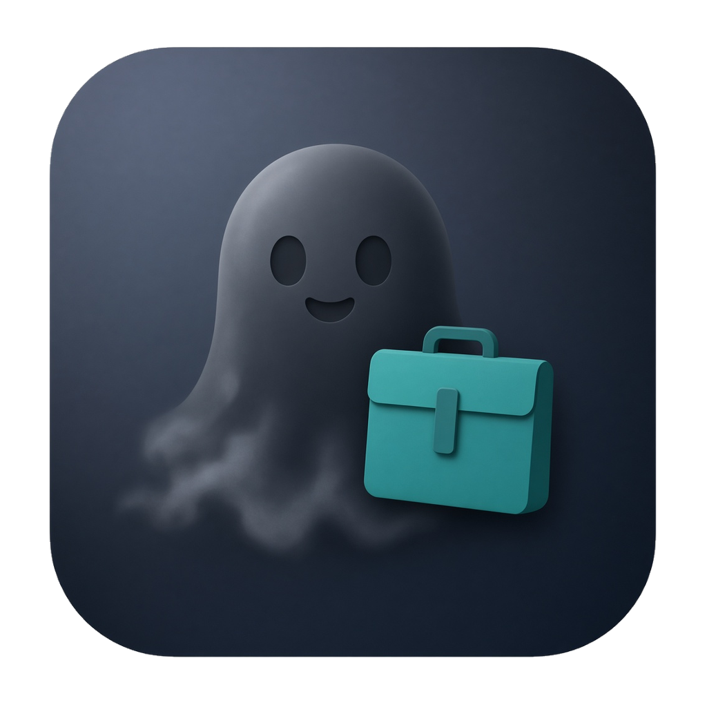

# Ghost Job

**你的 BOSS 直聘智能投递助手**

按你的求职方向自动筛选岗位，AI 对比简历判断匹配度，只把简历投给真正合适的公司。

<h3 align="center">在 AI 冲击旧行业的浪潮里，在新旧交替的变革中，<br />无论前路多么黑暗，这个世界的角落里，总有一盏灯为你点亮。</h3>

[](https://github.com/InfernalAzazel/ghost-job/stargazers)
[](https://github.com/InfernalAzazel/ghost-job/releases/latest)
[](https://github.com/InfernalAzazel/ghost-job/releases)
[](LICENSE)

[下载安装](https://github.com/InfernalAzazel/ghost-job/releases) · [快速开始](#快速开始) · [求职数据实测](#作者求职数据实测) · [常见问题](#常见问题) · [加入交流群](#加入交流群) · [请作者喝杯咖啡](#请作者喝杯咖啡)

如果 Ghost Job 帮你省下了投递时间，欢迎点击右上角的 ⭐ **Star** 支持一下，让更多求职者看到它

</div>

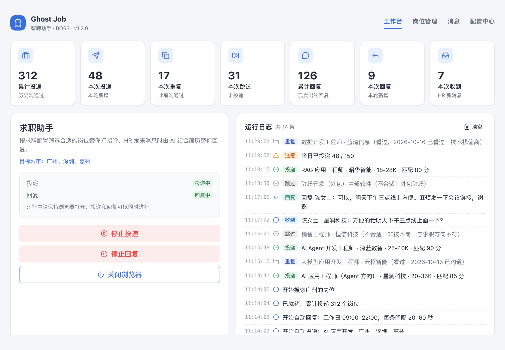

## 自动投递效果

左边是 BOSS 直聘，右边是 Ghost Job：投递时自动跳过看过的岗位并写明原因，在岗位管理里按「合适 / 不合适」查看判断结果，在配置中心随时调整求职方向和投递节奏。

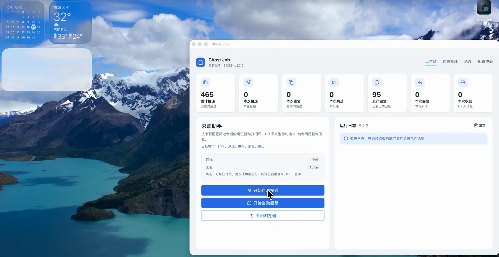

更高清的版本（2560×1320）：[下载视频](assets/videos/auto-apply.mp4)

## 项目初衷

找工作本身已经足够辛苦。Ghost Job 希望把重复、机械的投递工作交给程序，让求职者把精力留给准备面试、提升自己，更快找到合适的工作。

本项目免费提供使用，源码不公开，仅供个人求职、学习与研究使用，**禁止任何形式的商业用途**，包括但不限于：

- 出售本软件或基于本软件修改的版本
- 以本软件为基础提供付费代投、代招聘等服务
- 将本软件集成进商业产品或用于公司、机构的营利性业务

请合理使用，遵守 BOSS 直聘的用户协议，不要用于批量骚扰 HR 或其他损害平台与他人利益的行为。

## 为什么用 Ghost Job

每天刷几百个岗位、逐个点开看职责、再挨个点「立即沟通」，这些重复劳动交给 Ghost Job 就好。

- **自动投递**：按你的求职条件逐个查看岗位，符合条件就替你向 HR 打招呼，全程无需守在电脑前
- **多城市轮换**：可以同时选多个城市，一个城市的岗位看完了，自动切换到下一个
- **只看还在招人的岗位**：设定最低活跃档位（如「本周活跃」），不活跃的岗位既不投递、也不送进 AI 复核，省下无效沟通和大模型开销
- **AI 岗位筛选**：AI 阅读岗位职责，只投递符合你求职方向的岗位，销售、外包等一律避开
- **简历技术匹配**：上传简历后，AI 对比岗位技术要求与你的技能，给出 0 到 100 分的匹配度
- **匹配度过滤**：只投递匹配度达标的岗位，把每天有限的沟通次数花在刀刃上
- **像真人一样投递**：随机停顿、分批休息，每天节奏略有不同，降低账号风险
- **AI 自动回复**：HR 发来消息时，AI 结合你的简历和岗位信息回复，HR 索要简历时自动发送附件简历，只在白天的回复时段工作；HR 主动找你的新岗位也会按求职条件判断并记录
- **消息记录**：和 HR 的聊天按会话集中查看，哪些是 AI 自动回复的一目了然；刚投递的会话自动记录，几千个会话也能流畅切换
- **同步历史会话**：一键把 BOSS 上以前聊过的会话和聊天记录同步进来，对应岗位一并记录，方便集中复盘
- **沟通状态**：AI 识别到面试邀请会自动标记「有面试」，HR 拒绝、AI 婉拒也会自动标记；面试后可以手动标记「已面试」「面试通过」「面试不通过」，并按状态筛选会话
- **多种大模型可选**：默认使用 DeepSeek，也可以接入通义千问、Kimi、智谱、OpenAI 或本地 Ollama
- **查企业**：一键读取公司的工商信息，上网搜索欠薪、裁员、失信等负面信息，AI 给出低 / 中 / 高风险评估和依据，风险标签直接显示在岗位和会话列表里，完整结果可下载为 PDF 报告
- **求职分析**：用贝叶斯估计「投递有效 / 回复有效」两个概率，附可信区间、漏斗和分群；写下这次用了什么战略，AI 结合数据点评并给出下一步建议；每份报告冻结成快照，可与上一份对比、下载 PDF
- **数据导出**：岗位和聊天记录都能一键导出为 JSON，方便整理、复盘或交给其他工具处理
- **数据只在本机**：岗位记录、简历、API Key 全部保存在你自己的电脑上
- **新版本提醒**：顶部显示当前版本号，有新版本时旁边出现提示，点击直接打开下载页

## 快速开始

### 准备工作

1. 从 [Releases](https://github.com/InfernalAzazel/ghost-job/releases) 下载对应系统的安装包并安装
   - Windows：`.msi` 或 `.exe`
   - macOS：`.dmg`（Apple 芯片选 `aarch64`，Intel 选 `x64`）
   - Linux：`.AppImage` / `.deb` / `.rpm`

   > 目前已在 Windows 10 / 11 和 macOS 上测试可正常使用；**不支持 Windows 7**；Linux 版本尚未完整测试。
2. 安装 [Google Chrome](https://www.google.com/chrome/)（自动投递通过本机 Chrome 完成）
3. 准备一个大模型 API Key，推荐 [DeepSeek](https://platform.deepseek.com/api_keys)；也可以用通义千问、Kimi、智谱、OpenAI 等任意 OpenAI 兼容服务，或本地 Ollama

### 第一步：开通 AI 服务

打开 **配置中心 → AI 服务**：

1. 接口地址：使用 DeepSeek 时留空即可；使用其他服务时填写它的 OpenAI 兼容地址，例如本地 Ollama 填 `http://localhost:11434/v1`
2. 粘贴对应服务的 API Key（本地 Ollama 可随意填写）
3. 点击「获取模型列表」，选择一个模型
4. 点击「测试连接」，看到「连接成功」即可

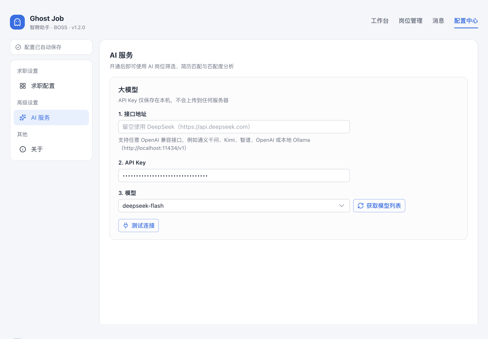

### 第二步：设置求职条件

打开 **配置中心 → 求职配置 → 岗位筛选**，告诉 Ghost Job 你想找什么工作：

- **基础条件**：岗位关键词（可填多个，输入后回车添加成标签）、目标城市（可多选）、求职类型、薪资范围
- **经验 / 学历 / 公司**：工作经验、学历、融资阶段、企业规模
- **Boss 活跃度**：只投「不低于」所选档位的岗位，例如设为「本周活跃」就跳过 2 周内及更旧的岗位；BOSS 的岗位列表不带活跃度，按岗位详情判断，读不到活跃度的岗位照常投递
- **行业与关键词**：只看感兴趣的行业；用「职位名排除」「屏蔽这些公司」避开不想要的岗位
- **AI 岗位筛选**（可选）：用一句话写清想投和不想投的方向，AI 帮你把关
- **投递节奏**：慢速 / 正常 / 快速，或自定义每条之间的停顿

所有修改自动保存。城市和关键词都按填写的顺序执行：选了「广州、深圳」就先投广州，广州的岗位看完再切到深圳；关键词填了「AI 应用工程师、Agent 工程师」就先把这个关键词在所有城市的岗位看完，再搜下一个关键词。也可以用多个关键词覆盖同一类岗位的不同叫法，压一压重复率。

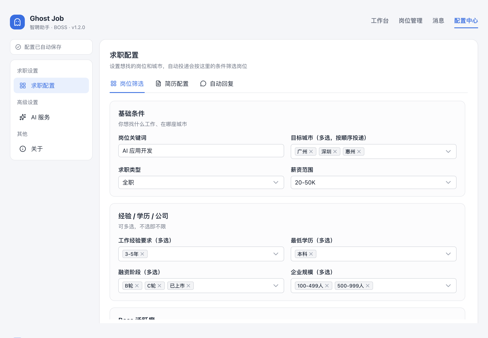

#### AI 岗位筛选

在岗位筛选页下方打开「AI 岗位筛选」，在「求职方向」里写清想投什么、不想投什么。写得越具体，筛选越准。

下面是一份可以直接参考的模板，按自己的方向修改即可：

```text
只投 AI 应用开发、AI Agent 工程师、AI 应用工程师、AI 后端工程师 等岗位。

薪资要求：16K～20K/月，优先选择明确标注薪资范围符合要求的岗位。

岗位要求以 Python、FastAPI、LLM、Agent、RAG、模型 API、工具调用、工作流、AI 应用系统落地 为核心，偏工程开发与实际业务落地，而非理论研究。

优先考虑 AI 产品研发、智能体开发、AI 平台开发、AI 应用系统研发 等岗位。

明确排除：

* 产品经理、销售、运营、市场
* 纯算法研究、纯数据分析
* 传统 CRUD 开发
* 纯前端开发
* 与 AI 应用开发关联较弱的岗位
* 外包公司、项目外包、技术外包、人力外包
* 劳务派遣、第三方派遣、驻场开发、外派岗位
* 以项目制交付为主的岗位

核心目标：寻找 16K～20K、以 Python + LLM + Agent 为核心、偏 AI 应用工程落地的正式研发岗位。
```

#### 用 AI 帮你改成自己的求职方向

上面的模板是按「AI 应用开发」写的。求职方向不同也不用从头写，交给 ChatGPT、DeepSeek、豆包、Kimi 等任意 AI 改写即可：

1. 复制上面的模板
2. 打开任意 AI 对话，先粘贴模板，再在后面写上你的要求，比如：

   ```text
   （这里粘贴上面的模板）

   这是一个让 AI 自动筛选 BOSS 直聘岗位的「求职方向」模板，请保留它的结构，帮我改成适合我的版本：
   - 想投：新媒体运营、IP 编导、企业号运营
   - 薪资：10K～15K/月
   - 不想投：纯销售、电话客服、需要长期出镜的主播、外包和派遣岗位
   直接输出改好的全文，不要解释。
   ```

3. 把 AI 生成的内容复制回「求职方向」，自动保存；正在投递的话，停止后重新开始投递才会生效
4. 同时把上方的「岗位关键词」改成新方向（如「新媒体运营」），否则搜出来的还是原来的岗位
5. 投递一段时间后，到「岗位管理」看看判断描述。有误判时，把例子告诉 AI 让它接着改，比如「『短视频销售』被判为合适，但我不想投，请加进排除项」。改完后勾选岗位点「AI 分析」，就能按新的求职方向重新判断

### 第三步：上传简历

切到 **简历配置**：

1. 点击「上传简历」选择 PDF，内容会自动识别，也可以直接粘贴修改
2. 打开「简历技术匹配」，投递前 AI 会对比岗位要求与你的技能
3. 需要更严格时，打开「匹配度过滤」并设置最低分数（默认 60 分）

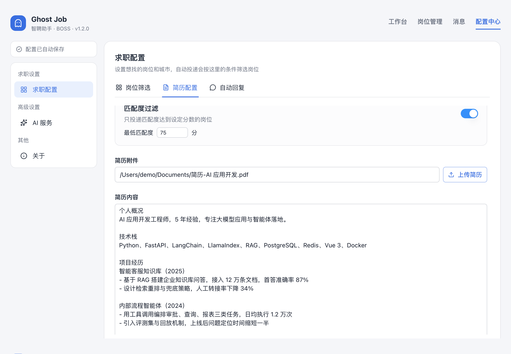

#### 简历技术匹配

打开「简历技术匹配」后，每个岗位投递前 AI 都会读一遍你的简历和岗位要求：

- 技术栈对不上的岗位直接跳过，运行日志里会写明原因
- 每个岗位会得到 0 到 100 分的匹配度，显示在「岗位管理」列表里
- 配合「匹配度过滤」，只投递达到最低分数的岗位，比如设为 60 分，低于 60 分的都不投

简历内容越完整，匹配越准。上传 PDF 后可以检查一下识别出来的文字，缺的技能、项目经历直接补上。

### 第四步：开始自动投递

回到 **工作台**，点击「开始自动投递」：

1. 首次使用会打开 Chrome，请在里面登录 BOSS 直聘，登录一次即可长期保持
2. Ghost Job 会按求职条件逐个查看岗位，符合条件的自动点击「立即沟通」；一个城市看完会自动切换到下一个城市，一个关键词的所有城市看完后接着搜下一个关键词
3. 运行日志实时显示每个岗位的处理结果；投递开始后按钮会变成「停止投递」，随时可以点击结束

所有关键词在所选城市的岗位都看完，或当天投递满 150 次，会自动停止，第二天可以继续。

### 第五步：查看与分析岗位

打开 **岗位管理** 查看所有看过的岗位，合适的和不合适的都会记录下来：

- 每个岗位都有「是否合适」和「判断描述」，比如「外包公司」「技术栈吻合」，鼠标移到描述上可查看完整内容
- 按「合适 / 不合适」（默认只看合适）和「已分析 / 未分析 / 高匹配」筛选，搜索岗位或公司
- 勾选岗位后点击「AI 分析」，按当前求职方向和简历重新判断是否合适，并更新匹配度
- 查看岗位详情，或批量删除不需要的记录。详情里的职位描述为空时（例如从会话同步进来的岗位），会自动到 BOSS 职位详情页读取一次并补全，读不到时点「重新读取」再试
- 点击操作列的「查企业」，读取 BOSS 公司主页的工商信息（企业全称、法人、注册资本、成立时间、经营状态等），用公司全称上网搜索欠薪、裁员、失信被执行等负面信息，再由 AI 综合评估为低风险、中风险、高风险或信息不足，并列出依据和来源链接。结果按公司保存，公司名旁显示风险标签，下次打开直接查看，点「重新查询」可刷新。没有配置 AI 服务时只展示工商信息和搜索结果
- 点击「导出全部」把所有岗位导出为 JSON；勾选岗位后点击「导出」，只导出勾选的岗位。导出包含全部字段（岗位信息、HR、是否合适、判断描述、匹配度、是否已投递、入库时间等）

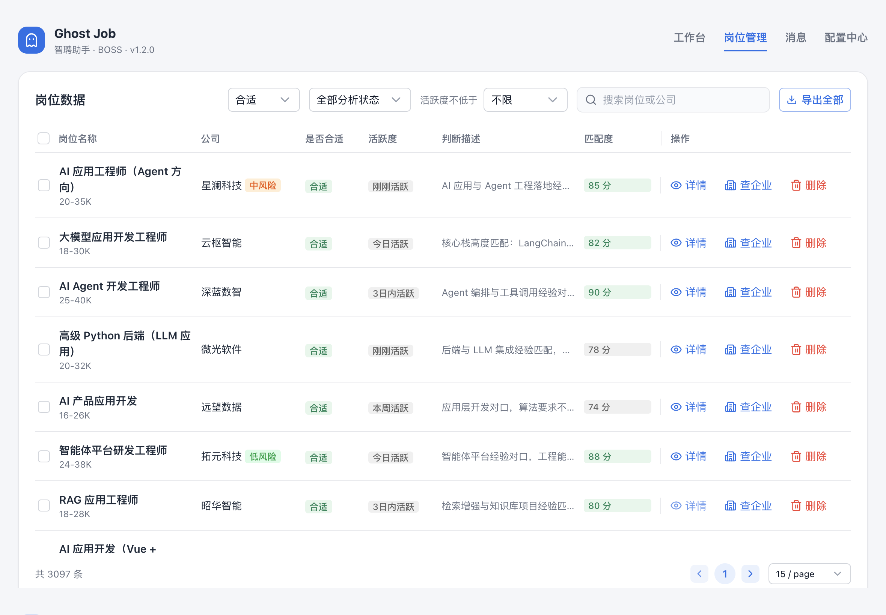

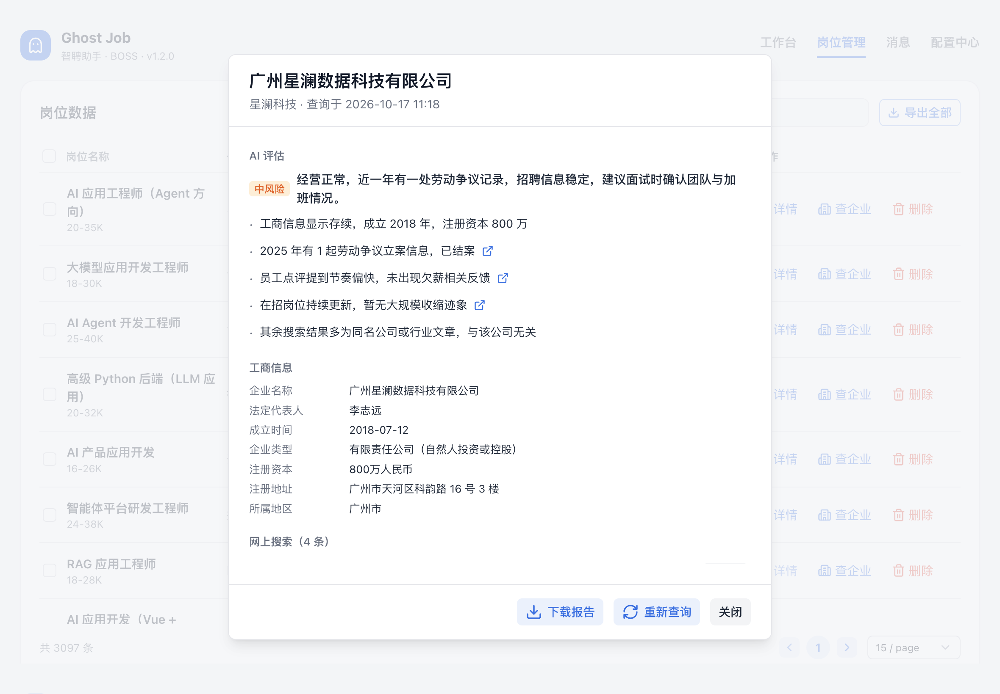

点「下载报告」后选择保存位置，得到一份 PDF 企业报告：AI 风险评估和依据、工商信息、网上搜索到的全部资料，来源链接可以直接点击打开，方便存档或分享。

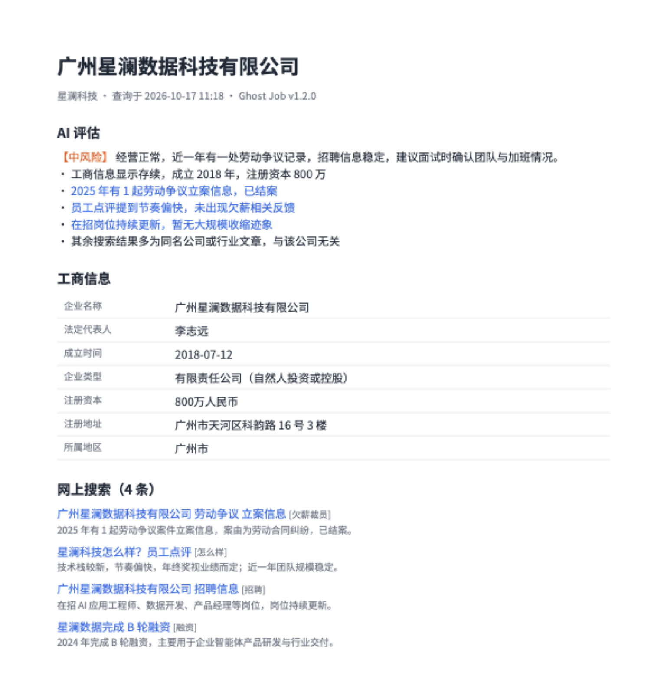

### 第六步：自动回复 HR 消息

1. 打开 **配置中心 → 求职配置 → 自动回复**，开启「启用自动回复」（需要先开通 AI 服务并上传简历；想让 HR 要简历时自动发送，还要在 BOSS 直聘上传附件简历）
2. 按需修改「回复提示词」，比如语气、薪资怎么回答、到岗时间（可参考下方的模板）
3. 在最下方的「回复节奏」选择慢速 / 正常 / 快速，或自定义回复时段、每条回复前的等待时间和休息间隔；不在回复时段收到的消息，会顺延到下一个时段再回
4. 回到 **工作台**，点击「开始自动投递」下方的「开始自动回复」，可以和自动投递同时运行；需要结束时点击「停止回复」

#### 回复提示词模板

AI 回复时会参考你的简历、沟通的岗位、岗位是否合适的判断和最近的聊天记录，提示词只需要写清楚「怎么回」。下面是一份可以直接参考的模板，按自己的情况修改即可：

```text
你是正在求职的我，在 BOSS 直聘上和 HR 沟通。请根据我的简历回复 HR 的最新消息。
一切以我的利益为最高原则：不为了迎合 HR 让步，不轻易答应对我不利的条件。

基本要求：
* 语气礼貌、真诚、口语化，像真人聊天，每次回复不超过 80 字
* 只根据简历里的真实经历回答，不编造经历、技能、证书和学历
* 不重复打招呼，不用表情符号，不说「作为 AI」之类的话

常见问题怎么回：
* 索要简历：简短回应即可，如「好的，简历发您了，请查收」，程序会自动发送附件简历
* 问薪资：期望 16K～20K/月，可根据岗位职责和整体待遇再沟通
* 问到岗时间：离职后一周内可到岗
* 问简历里没有的技能或经历：如实说明没有相关经验，可以补充相近的经历
* 问学历、证书等硬性条件：如实回答，不回避

面试方式（第一轮优先线上）：
* 问能否面试：表示可以，希望第一轮先线上面试（视频或电话），请对方告知时间
* 约线下面试（如「什么时候方便过来面试」）：先礼貌询问第一轮能否改为线上，给一个合理的理由，
  并表示第二轮可以到公司面谈。理由要符合简历里的真实情况：简历显示仍在职，可以说「目前还在职，
  白天不方便请假」；已离职，可以说「近期面试安排比较密集」；距离较远，可以说「往返需要半天」
* 第二轮及之后的面试：可以接受线下，请对方告知时间和地址
* HR 坚持第一轮必须线下：礼貌婉拒，感谢对方，表示如果之后可以线上沟通再联系

岗位不合适时：
* 岗位判断为不合适，或是外包、驻场、派遣、与 AI 应用开发无关的岗位，礼貌说明方向不一致并感谢对方，不再追问细节
* HR 明确表示不合适或岗位已招满时，不用回复
```

「面试方式」这一段让第一轮先线上面试，避免 HR 只是为了完成邀约 KPI 让你白跑一趟，确认对方有诚意后第二轮再去线下；不需要的话删掉即可。「岗位不合适时」这一段和「HR 坚持第一轮必须线下」决定 AI 什么时候替你婉拒，婉拒后会话会被标记，见下文。

#### 用 AI 帮你改成自己的回复提示词

和求职方向一样，回复提示词也可以让 AI 按你的情况改写：

1. 复制上面的模板
2. 打开任意 AI 对话，先粘贴模板，再在后面写上你的情况，比如：

   ```text
   （这里粘贴上面的模板）

   这是一个让 AI 替我在 BOSS 直聘上回复 HR 的提示词，请保留它的结构，按我的情况修改：
   - 求职方向：新媒体运营、IP 编导、企业号运营
   - 期望薪资：10K～15K/月
   - 目前已离职，随时可以到岗
   - 线下面试也可以接受，不用坚持第一轮线上
   - 语气轻松一些，每次回复不超过 60 字
   直接输出改好的全文，不要解释。
   ```

3. 把 AI 生成的内容复制到「回复提示词」，重新开启自动回复后生效
4. 检查一遍薪资、到岗时间、学历等内容是否属实；「索要简历」「岗位不合适时」这两段建议保留，它们和自动发简历、婉拒标记配合使用
5. 运行一段时间后，在运行日志或消息页看看 AI 的回复。哪里不满意，就把原句发给 AI 让它接着改，比如「HR 问『能接受单休吗』时回得太含糊，我希望明确表示只考虑双休」

HR 发来的消息和 AI 的回复都会显示在运行日志里。如果是 HR 主动找你、之前没看过的岗位，会先按求职条件和 AI 岗位筛选判断，再记录到岗位管理。

**自动发送简历**：分两种情况。

- **HR 索要简历**（聊天里出现「我想要一份您的附件简历」卡片）：自动点卡片上的「同意」，简历**直接发给对方**，运行日志显示「已同意 HR 的附件简历请求」
- **AI 判断该发简历、但 HR 没有索要**（比如聊到简历）：点聊天窗口的「发简历」并发出一条简历请求，对方同意后才发到邮箱，运行日志显示「已发送附件简历请求，对方确认后发到邮箱」

两种都是发你在 BOSS 直聘上传的附件简历。卡片没点成时，会兜底去发一条简历请求，别让 HR 要的简历漏掉，运行日志会显示「点「同意」没成功，改发一条简历请求」；双方还没互动、按钮不可用，或者还没上传附件简历时，会提示你手动发送。

**沟通状态**：每个会话有一个沟通状态，AI 回复时会自动更新：

- HR 明确表示不合适（如「暂不匹配」「岗位已招满」）时不会再回复，标记为「HR 已拒绝」；岗位不合适、AI 已替你婉拒的标记为「AI 已婉拒」。之后 HR 再发来新消息，AI 会重新判断要不要继续沟通，继续沟通时会清掉这个标记
- HR 发出面试邀请，或者正在和你约面试时间、地点、方式时，标记为「有面试」，运行日志会显示「识别到面试邀请，已标记有面试」；只是介绍面试流程（如「我们是线下面试」）不算
- 面试之后可以手动标记「已面试」「面试通过」或「面试不通过」，这三种状态 AI 不会改动；「面试不通过」和「HR 已拒绝」「AI 已婉拒」一样，HR 没有新消息时不再回复

打开 **消息** 可以查看和每位 HR 的聊天记录：

- 自动回复运行时，新出现的会话（比如刚投递、BOSS 替你发了打招呼的）会自动记录进来，不用等 HR 回复
- 左侧是会话列表，最后一条消息最新的在最前（自动回复、同步进来的新消息都会立刻反映出来）；支持按 HR、公司或岗位搜索，点搜索框里的 × 清空；每个会话显示沟通状态标签，有面试、面试通过为绿色，面试不通过、HR 已拒绝为红色，已面试为蓝色，AI 已婉拒为灰色。往下滚动自动加载更多
- 点击搜索框旁的筛选按钮，可以只看某一种沟通状态，选「无状态」查看还没有任何状态的会话，或者选「所有面试」查看有面试、已面试、面试通过、面试不通过的会话
- 右侧是聊天内容和沟通的职位，AI 自动回复的消息会单独标注；右上角的「沟通状态」下拉可以手动修改当前会话的状态，选「无」即清除
- 会话顶部点击「查企业」，查看这家公司的工商信息、网上负面信息和 AI 风险评估，与岗位管理里的查企业共用结果；查过的公司在会话列表里显示风险标签
- 列表底部点击「导出全部」，把所有会话导出为 JSON，每个会话包含 HR、公司、岗位、沟通状态和完整的聊天记录；勾选会话后点击「导出」，只导出勾选的会话
- 勾选会话后点击「删除」批量删除，没勾选时点击「删除当前」删掉打开的会话；聊天记录和沟通状态一起从本地删除，之后点「同步」会重新从 BOSS 把这些会话和记录读回来

**同步历史会话**：点击搜索框旁的同步按钮，把 BOSS 上以前聊过、还没记录下来的会话和聊天记录同步进来：

- 对应的岗位也会记录到岗位管理：新岗位只按岗位筛选里的关键词判断，其余标为「合适 · 待 AI 分析」，需要时在岗位管理里勾选做 AI 分析
- 同步只读取、不回复，每个会话之间会停顿几秒；会话多时要一段时间，可以随时停止，下次点同步会从剩下的继续

> [!WARNING]
> 同步会连续读取大量会话，建议先在工作台停止自动投递和自动回复再同步，避免同一时间访问 BOSS 过于频繁，降低账号被风控的风险。自动投递或自动回复运行时无法开始同步，同步时也无法开始投递或开启自动回复。

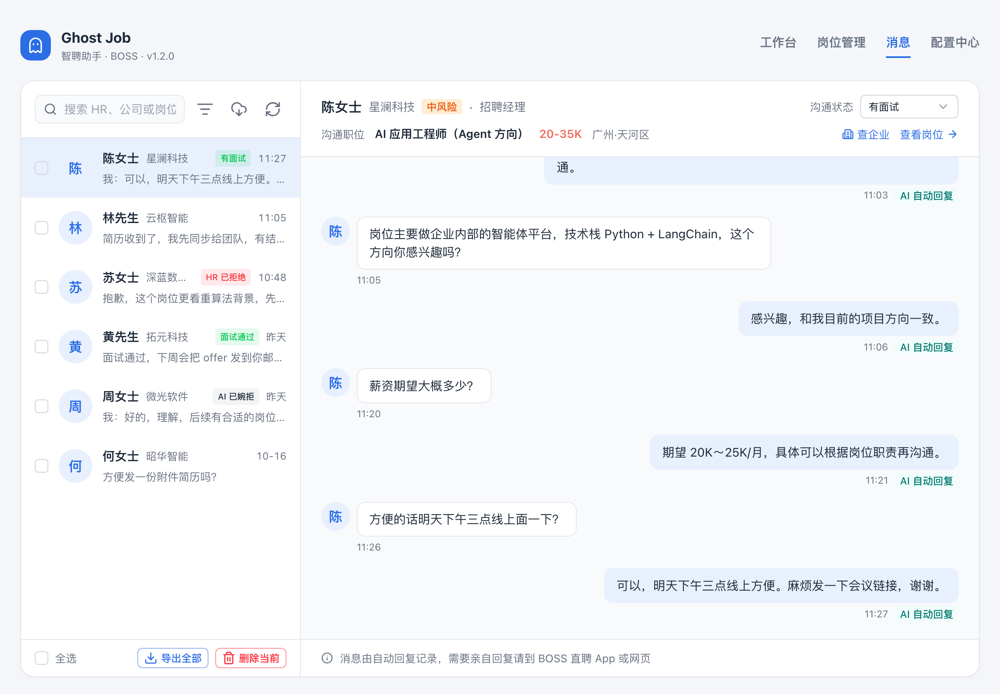

### 第七步：求职分析

打开 **求职分析**，看看投递到底卡在哪一步。程序统计全部已投递岗位和聊天记录，用贝叶斯估计两个概率，配上漏斗和分群，再让 AI 结合你记录的战略做解读。

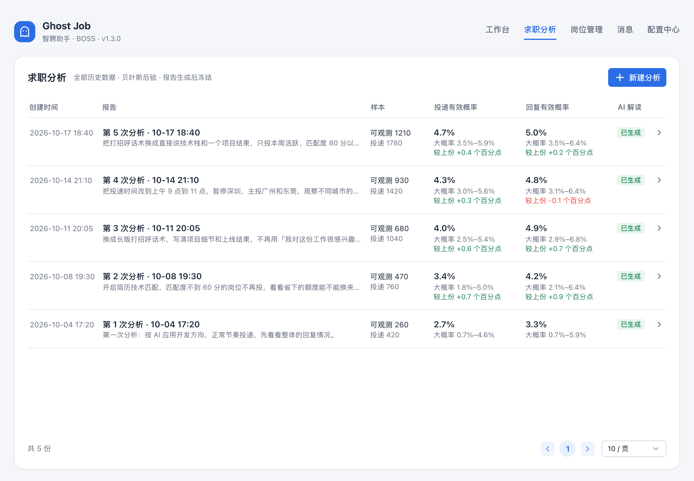

#### 新建一份分析

1. 点击右上角「新建分析」。弹窗会先显示这次统计的样本：已投递多少岗位、其中多少有聊天记录可观测、多少条会话可统计回复。
2. 在「这次用了什么战略」里写下最近做过的调整，比如「把打招呼话术换成直接说技术栈」「只投本周活跃的岗位」。标题留空会自动命名成「第 N 次分析 · 月-日 时:分」。
3. 点「开始分析」。程序先统计并冻结快照，再让 AI 写解读，最长约 1 分钟，期间不要关闭窗口。

还没有可观测的投递时，「新建分析」是灰的：先在工作台投递，或者到消息页点「同步」把历史会话读进来。没有配置 AI 服务也能生成报告，两个概率、漏斗和分群照常计算；配置好 AI 服务后，回到详情点「生成解读」即可补上解读。

战略只随报告存档并交给 AI 点评，程序不会按它做因果归因。想让它点评得更准，就把改了什么写具体，比如把「优化了打招呼」写成「把『我对这份工作很感兴趣』换成一句技术栈 + 一个上线项目」。

#### 看懂两个概率

- **投递有效概率**：已投递且有聊天记录可观测的岗位里，HR 发过至少一条消息的比例。打完招呼没有下文的岗位算失败。
- **回复有效概率**：AI 自动回复过的会话里，HR 之后又发过消息的比例。聊到一半不再回复的算失败；只手动聊过、没有自动回复的会话不计入这项分母。

两个概率都先验取 `Beta(1, 1)`（不预设你「应该」有多少回复率），报告显示后验均值和 95% 可信区间，例如「4.7%，大概率在 3.5%–5.9% 之间」。

- 先看区间，再看数字。样本越少区间越宽，样本不足 10 次会标注「样本不足 10 次，区间很宽，仅供参考」。
- 没有聊天记录的投递属于「不可观测」，不计入概率分母，避免把「还没同步到」误算成 HR 不回复；详情里会单独显示有多少个这样的投递。
- 有新报告时，会显示和上一份相比变化了多少个百分点；第一份没有对比基准。

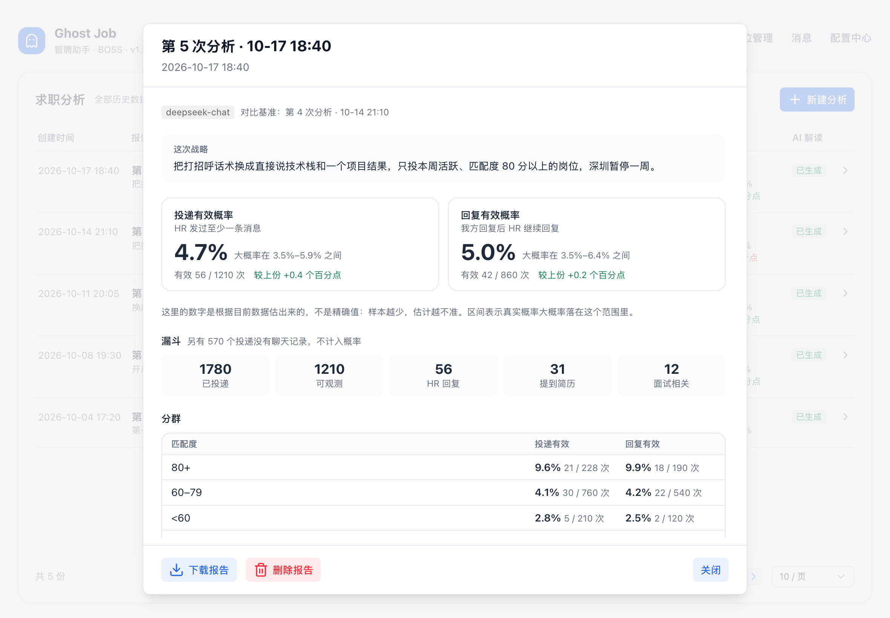

#### 漏斗和分群

- **漏斗**：已投递 → 可观测 → HR 回复 → 提到简历 → 面试相关，用来看人主要流失在哪一步。「提到简历」按 HR 消息里出现「简历」统计，「面试相关」按沟通状态里的有面试、已面试、面试通过、面试不通过统计。
- **分群**：按匹配度（80+ / 60–79 / <60 / 未评分）、HR 活跃度（今日及更活跃 / 3日内或本周 / 更早或未知）、公司风险（低 / 中 / 高 / 未查询）拆开看两个概率和样本数，方便判断哪类岗位更值得投。
- 单个档位样本很少时（比如不到 5 次），百分比只能当参考；「未查询」表示这家公司还没查过企业风险，或查到的信息不足。

#### AI 解读和战略

详情最下方是 AI 解读：总体判断、当前卡点、3–5 条带数字的关键发现、战略点评，以及 3–4 条可执行建议。

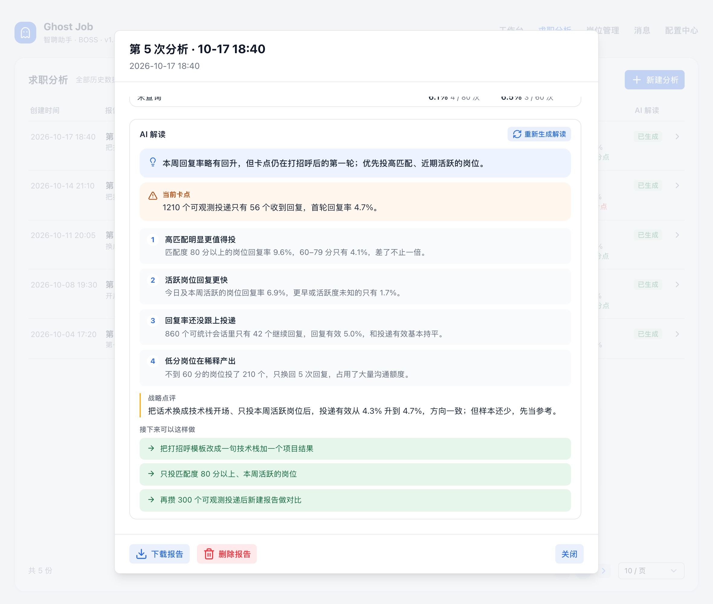

- 发现和建议都基于报告里冻结的数字，AI 不参与统计，也不会重新算概率。
- 战略点评只判断方向是否一致，不会说成「因为改了话术所以提升」。两次的波动范围重叠较多时，会直接提示「可能只是正常波动」。
- 生成失败时点「生成解读」，想换一种说法时点「重新生成解读」；两者都只重跑 AI，这份报告的统计快照不变。

#### 对比、下载和删除

- 每份报告在生成时冻结：以后岗位和聊天记录继续变化，旧报告的数字也不会变。想看新数据，再新建一份分析。
- 新报告会自动与上一份比较，列表和详情里都会显示两个概率变化了多少个百分点。
- 详情里点「下载报告」，可以把战略、两个概率、漏斗、分群和 AI 解读存成 PDF，方便存档或发给朋友看。
- 点「删除报告」只删这份报告，岗位和聊天记录不受影响。

> [!NOTE]
> 可信区间描述的是「成功率落在哪个范围」，不是保证。样本不足时请结合岗位质量判断，不要只盯一个百分比。

## 作者求职数据实测

作者用 Ghost Job 在 BOSS 直聘上找了半个月工作（2026.09.12 – 10.04），把投递和回复的每个环节按转化率拆开算了一遍：**2926 次打招呼，换来 34 个聊到面试的机会**。

### 转化率篇

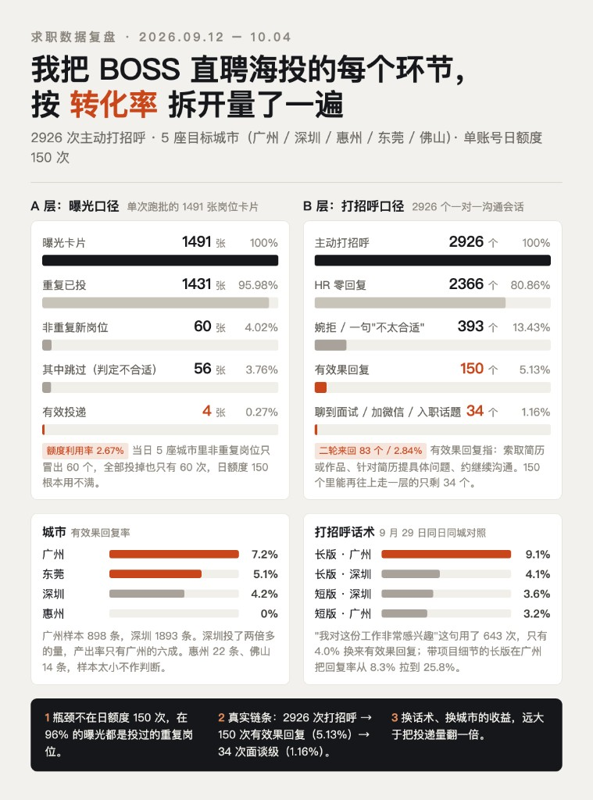

#### 第一层：投递

单次跑批曝光 1491 张岗位卡片：1431 张是已投过的重复，占 95.98%；跳过 56 张不合适；真正投出去 4 张。每天 150 次的沟通额度只用掉 2.67%，当天 5 座城市（广州、深圳、惠州、东莞、佛山）里非重复的岗位一共只冒出 60 个，全投掉也只有 60 次。

#### 第二层：回复

主动打招呼 2926 个，HR 零回复 2366 个，占 80.86%。有回复的 560 个里，393 个是一句「不太合适」的婉拒。有推进价值的（要简历、问细节、约继续聊）150 个，占 5.13%；再往上走到面试、加微信、谈入职的 34 个，占 1.16%。

#### 三个反直觉的发现

1. **瓶颈在重复率，不在投递额度**。已投过的岗位越多，能看到的新岗位就越少，每天 150 次额度根本用不满。
2. **城市差异很大**。广州有效回复率 7.2%，深圳 4.2%。深圳投了两倍多的量（1893 条对广州 898 条），产出率却不到广州的六成。
3. **打招呼话术差别极大**。「我对这份工作非常感兴趣」用了 643 次，只有 4.0% 换来有效回复；写清项目细节的长版话术在广州做到 9.1%。

**结论：产出主要由话术、城市和重复率决定，投递次数排在后面。** 与其想办法多投，不如先打磨打招呼语、多试几个城市。

> 样本是单账号、5 座城市、半个月的会话记录，回复分类用关键词判定，边界约有 ±10 条误差；惠州（22 条）、佛山（14 条）样本太少，不作判断。结果仅供参考，不同岗位方向和城市的情况可能不同。

### 手动投递篇

手动投递最绝望的是不停刷到投过的岗位：**手动投满 150 次，得滑 3728 张岗位卡，其中 3578 张是已经投过的重复**。

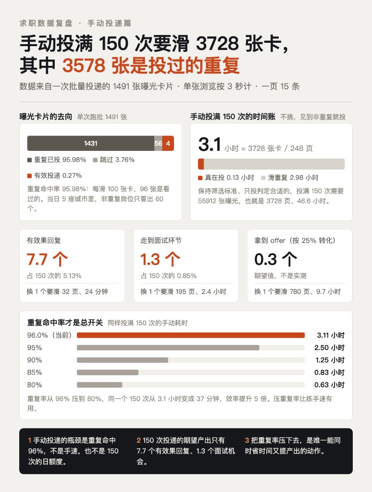

#### 重复命中 95.98%

拉一次批量投递的曝光数据：1491 张岗位卡里，1431 张重复、56 张判定不合适、真正投出去的 4 张。每滑 100 张，有 96 张是看过的。

#### 手动的时间账

按 3 秒一张、一页 15 条算：

- **不挑，见到非重复就投**：3728 张卡 = 248 页 = 3.1 小时，其中 2.98 小时花在重复卡片上
- **保持筛选标准，只投判定合适的**：55912 张曝光 = 3728 页 = 46.6 小时

#### 投出去之后的有效率

150 次投递的期望产出：7.7 个有效回复（5.13%）、1.3 次面试机会（0.85%）、0.3 个 offer。

换算成滑动成本：换 1 个有效回复要滑 32 页、24 分钟；换 1 次面试机会要滑 195 页、2.4 小时；换 1 个 offer 要滑 780 页、9.7 小时。

#### 重复率才是总开关

同样投满 150 次，手动耗时随重复率变化：

| 重复率 | 手动耗时 |
| --- | --- |
| 96%（当前） | 3.11 小时 |
| 95% | 2.50 小时 |
| 90% | 1.25 小时 |
| 85% | 0.83 小时 |
| 80% | 0.63 小时 |

重复率从 96% 压到 80%，手动耗时从 3.1 小时降到 37 分钟，差 5 倍。压重复率的办法：换城市、换关键词、拉长两次批量投递的间隔、别反复刷同一批岗位。

日额度 150 次用不满，原因不在手速。当天 5 座城市里非重复岗位只有 60 个，天花板压在那里。

> 样本是单次跑批的 1491 张曝光卡片，滑动速度按 3 秒一张估算，offer 的 0.3 个是按 25% 面试转化率外推出来的期望值，不是实测。

### 自动投递与手动投递对比

同样面对 96% 的重复率，两种方式的差别主要在「谁来滑这些重复卡片」：

| | 手动投递 | Ghost Job 自动投递 |
| --- | --- | --- |
| 跳过重复岗位 | 靠人眼辨认，每滑 100 张有 96 张白看 | 看过的岗位自动记录，再遇到直接跳过，不调用 AI |
| 投满 150 次的人工耗时 | 不挑 3.1 小时，保持筛选标准 46.6 小时 | 点「开始自动投递」后无需守在电脑前 |
| 岗位筛选 | 逐个点开看职责，标准容易随疲劳放松 | AI 按求职方向和简历匹配度判断，每个岗位写明原因 |
| 多城市 | 手动切换、重新搜索 | 一个城市看完自动切到下一个 |
| HR 回复 | 需要随时盯着消息 | AI 自动回复，HR 要简历时自动发送附件简历 |
| 复盘 | 难以统计 | 岗位、会话、沟通状态集中记录，可导出 JSON |

需要说明的是，自动投递省掉的是滑卡片、看职责、回消息的人工时间，**改变不了当天新岗位的数量**：5 座城市只有 60 个非重复岗位时，自动投递同样只能投 60 次。想提高产出，仍然要靠换城市、换关键词、打磨打招呼话术来压低重复率。

## 常见问题

**会重复投递同一个岗位吗？**
不会。看过的岗位都会记录下来，再次遇到同一个岗位（职位相同，或招聘标题、公司、HR 都相同）会直接跳过，不再重复调用 AI；之前已经沟通过的岗位也会跳过。工作台顶部的统计卡会分别显示本次投递、本次重复和本次跳过的数量。

**从旧版本升级，数据怎么带过来？**
直接安装 1.0.0 即可。首次启动会检测到旧版数据并弹出窗口，点「一键导入」把求职配置、AI 与回复设置、岗位、聊天消息、沟通状态、会话进度和企业数据搬过来，旧数据不会被修改。

导入时会自动适配老库：旧版本没有的表跳过，缺的列补空值（岗位的「活跃度」是 v0.6.9 才有、企业的品牌 ID 是 v0.2.0 之后才有），所以**不需要先装某个过渡版本**，老库也不会因为缺列打不开。个别数据行解析失败会记到 `logs/migrate.log`，其余照常导入。

| 来源版本 | 升级方式 |
| --- | --- |
| v0.6.9 – v0.7.2 | 直接安装 1.0.0，一键导入，数据全部保留 |
| v0.6.0 – v0.6.8 | 同上；导入后岗位的「活跃度」为空，重新筛一次即可 |
| v0.5.x 及更早 | 技术上同样能导入（缺表跳过、缺列补空值），但这些版本的数据字段本就不全，**建议清空数据重新开始**，见下一条 |

**想把旧数据清干净、从头开始？**
退出 Ghost Job，删掉数据目录下的 `db/` 和 `ghost-job.db`，再打开应用，重新填写求职配置、API Key 并上传简历。数据目录默认是 `~/.ghost-job`（可用环境变量 `GHOST_JOB_HOME` 改）。

同目录下还有别的东西，按需处理：`chrome-profile/` 是 Chrome 登录状态（删了要重新登录 BOSS 直聘）、`resumes/` 是配置中心上传的简历、`logs/` 是运行日志。**只想重置数据、不想重新登录的话，别动 `chrome-profile/`。**

**升级后岗位管理里的「活跃度」是空的？**
活跃度是 v0.6.9 新增的字段。从旧版本升级上来时它会被自动补成空值，之前看过的岗位不会回溯填写，所以按活跃度筛选时这些旧岗位不落在任何档位；新投递的岗位会正常记录。另外筛选只认 BOSS 常见的那些写法（如「刚刚活跃」「3日内活跃」），极少数没见过的写法查不到，但不影响投递时的判断。

**活跃度筛选从多选变成「不低于」了？**
是的。以前可以勾选多个档位，现在改成只设一个最低档位，更贴合「只看还在招人的」这个用途。因为这个改动，旧版本里选好的活跃度会重置为「不限」，需要重新设一次。

**为什么有岗位被跳过了？**
运行日志会写明原因，例如不符合关键词、AI 判断方向不符、匹配度不足或此前已沟通。

**岗位关键词能填多个吗？**
可以。在「岗位关键词」里输入一个按回车，就变成一个标签，点标签上的 × 可以删掉，也可以粘贴多个一次加进来。投递时按标签顺序执行，每个关键词都会把所选城市搜一遍；同一个关键词换城市时日志写「广州的岗位已看完，切换到深圳」，换到下一个关键词时写「深圳的岗位已看完，切换到广州（Agent 工程师）」。本轮结束的日志会带上关键词，例如：

```text
岗位关键词「AI 应用工程师、Agent 工程师」，所选城市的岗位都看完了：本次投递 6 条，重复 1470 条，跳过 24 条，累计投递 572 条
```

注意多一个关键词就多一轮搜索，用的还是每天的 150 次沟通额度，关键词别填太多。

**自动回复发的是哪份简历？**
发的是你在 BOSS 直聘上传的附件简历，不是配置中心里上传的简历（那份只给 AI 参考回复用）。

**除了 DeepSeek 还能用哪些大模型？**
任何兼容 OpenAI 接口的服务都可以，例如通义千问、Kimi、智谱、OpenAI。在 **配置中心 → AI 服务** 的「接口地址」填写该服务的地址，再填 API Key、获取模型列表即可；用本地 Ollama 时填 `http://localhost:11434/v1`，API Key 随意填写。接口地址留空就是 DeepSeek。

**每天能投多少个？**
BOSS 直聘每天约 150 次沟通上限，Ghost Job 会在达到上限时自动停止。

**支持哪些系统？**
已在 Windows 10 / 11 和 macOS 上测试可正常使用。不支持 Windows 7。Linux 提供了安装包，但尚未完整测试，遇到问题欢迎反馈。

**macOS 提示「无法验证开发者」怎么办？**
在应用上右键选择「打开」，或前往「系统设置 → 隐私与安全性」点击「仍要打开」。

**我的数据存在哪里？**
全部在本机 `~/.ghost-job/` 目录：岗位、配置与聊天记录在 `db/`，简历在 `resumes/`，Chrome 登录状态在 `chrome-profile/`，日志在 `logs/`（提 Issue 时可以附上，注意去掉个人信息）。目录下的 `ghost-job.db` 是早期版本用的数据库，现在只在首次启动时被读取一次用于导入旧数据，之后不再改动，可以留着备份。

**遇到问题怎么反馈？**
到 [Issues](https://github.com/InfernalAzazel/ghost-job/issues) 描述你遇到的问题，附上版本号、操作系统和运行日志（注意去掉手机号、简历等个人信息）。

## 加入交流群

使用中遇到问题、有功能建议，或想和其他求职者交流经验，欢迎扫码添加作者微信，备注「Ghost Job」，拉你进交流群。


## 请作者喝杯咖啡

Ghost Job 免费、没有广告，也没有商业化打算。如果它帮你省下了投递的时间，或者让你拿到了面试，欢迎扫码请作者喝杯咖啡。


## Star 趋势

每一个 Star 都是继续更新的动力。如果 Ghost Job 帮你拿到了面试，欢迎点个 ⭐ Star，或者推荐给身边正在找工作的朋友。

<a href="https://star-history.com/#InfernalAzazel/ghost-job&Date">
  <picture>
    <source media="(prefers-color-scheme: dark)" srcset="https://api.star-history.com/svg?repos=infernalazazel/ghost-job&type=Date&theme=dark" />
    <source media="(prefers-color-scheme: light)" srcset="https://api.star-history.com/svg?repos=infernalazazel/ghost-job&type=Date" />
    
  </picture>
</a>

## 许可证

本项目采用 [PolyForm Noncommercial License 1.0.0](LICENSE) 许可证：个人使用、学习研究、公益与教育机构等非商业用途可以免费使用和分发；**任何商业用途均不被允许**。本项目不提供源码，因此不涉及对源码的修改。

分发本软件或修改版本时，请保留 LICENSE 文件以及其中的 `Required Notice` 版权声明。
