<div align="center">

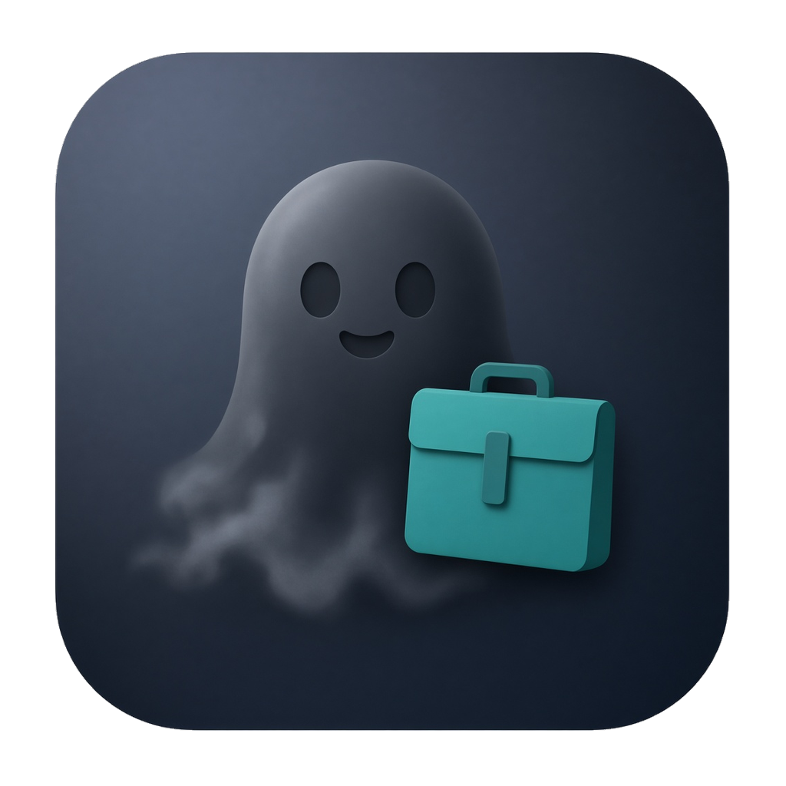

# Ghost Job

**你的 BOSS 直聘智能投递助手**

按你的求职方向自动筛选岗位，AI 对比简历判断匹配度，只把简历投给真正合适的公司。

<h3 align="center">在 AI 冲击旧行业的浪潮里，在新旧交替的变革中，<br />无论前路多么黑暗，这个世界的角落里，总有一盏灯为你点亮。</h3>

[](https://github.com/InfernalAzazel/ghost-job/stargazers)
[](https://github.com/InfernalAzazel/ghost-job/releases/latest)
[](https://github.com/InfernalAzazel/ghost-job/releases)
[](LICENSE)

[下载安装](https://github.com/InfernalAzazel/ghost-job/releases) · [快速开始](#快速开始) · [求职数据实测](#作者求职数据实测) · [防封指南](#防封指南) · [常见问题](#常见问题) · [加入交流群](#加入交流群) · [请作者喝杯咖啡](#请作者喝杯咖啡)

如果 Ghost Job 帮你省下了投递时间，欢迎点击右上角的 ⭐ **Star** 支持一下，让更多求职者看到它

</div>

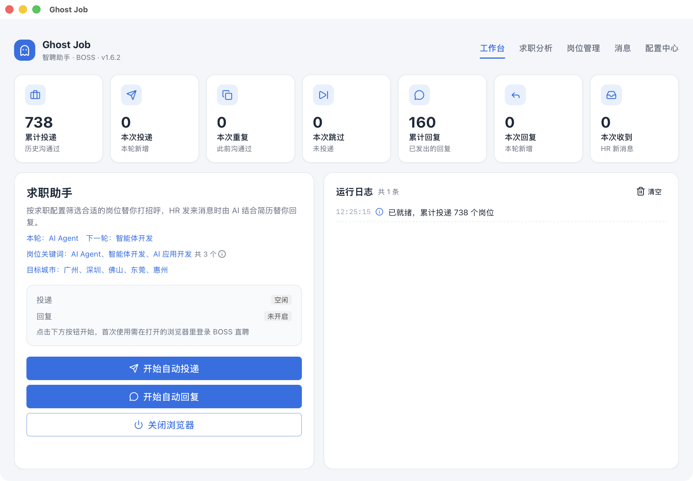

## Ghost Job 是什么

Ghost Job 是一款**免费的 BOSS 直聘自动投递桌面软件**，支持 Windows、macOS 和 Linux。它按你设定的岗位关键词和城市自动搜索岗位，用 AI（默认 DeepSeek）阅读职位描述、对比简历打出匹配度，只向合适的岗位打招呼；HR 回复后，AI 还能自动回复消息、发送简历和作品。所有数据都保存在本机，不需要写代码，安装后填好 API Key 就能用。

Ghost Job is a free desktop app (Windows / macOS / Linux) that automates job applications on BOSS Zhipin (BOSS直聘), China's largest recruiting platform. It uses an LLM to screen job descriptions against your resume, applies only to matching jobs, and replies to recruiters automatically.

| 项目 | 说明 |
| --- | --- |
| 适用平台 | BOSS 直聘（zhipin.com） |
| 软件类型 | 桌面应用，无需编程，也不是浏览器插件或脚本 |
| 支持系统 | Windows 10 / 11、macOS（Apple 芯片与 Intel）、Linux |
| 价格 | 免费，无广告，仅限个人非商业使用 |
| AI 模型 | DeepSeek、通义千问、Kimi、智谱、OpenAI 或本地 Ollama |
| 核心功能 | 自动投递、AI 岗位筛选、简历匹配度、AI 自动回复 HR、自动发简历与作品、查企业风险、求职数据分析 |
| 数据存储 | 全部保存在本机，不上传服务器 |

## 自动投递效果

左边是 BOSS 直聘，右边是 Ghost Job：投递时自动跳过看过的岗位并写明原因，在岗位管理里按「合适 / 不合适」查看判断结果，在配置中心随时调整求职方向和投递节奏。


更高清的版本（2560×1320）：[下载视频](assets/videos/auto-apply.mp4)

## 一个求职段子

> **面试官**：看简历了解到你有两年半的送外卖经验，可以简单地说一下平时是怎么送外卖的吗？
>
> **我**：我首先在平台上接单，然后到店里取餐，取到餐后骑电动车到顾客留下的地址，再通知顾客取餐。
>
> **面试官**：你们也用电动车配送吗？说一下电动车的运行原理。
>
> **我**：电动车的工作原理是通过锂电池释放存储的电能，经过电控系统将电能转化为电动车的机械能，然后电动机驱动电动车的机械结构，从而推动电动车行驶。
>
> **面试官**：锂电池具体是怎么把化学能转化为电能的呢？说一下锂电池化学成分以及反应方程式。
>
> **我**：好的。锂电池把化学能转化为电能，本质上靠的是锂离子在正负极之间的定向迁移，同时让电子走外电路做功。我以最常见的磷酸铁锂电池为例：
>
> - 结构上，它正极是磷酸铁锂，负极是石墨，中间是含锂盐的电解液，还有一层隔膜只让锂离子通过、不让电子通过。
> - 放电时，负极石墨里储存的锂原子特别「活泼」，会自动失去电子变成锂离子进入电解液。
> - 这些电子沿着外部导线跑到正极，形成电流，就能驱动电机——这就是化学能变电能的过程。
> - 同时，锂离子穿过隔膜到达正极，和正极材料、电子结合，生成新的化合物。
>
> 具体的反应方程式是：
>
> - 负极：LiC₆ → C₆ + Li⁺ + e⁻
> - 正极：FePO₄ + Li⁺ + e⁻ → LiFePO₄
> - 总反应：LiC₆ + FePO₄ → C₆ + LiFePO₄
>
> 充电时这些反应反向进行，把电能又存成化学能。所以整个过程就是锂离子在正负极间来回「搬家」，伴随电子在外电路流动，实现能量转换。
>
> **面试官**：你们平时送外卖用的是什么牌子的电动车？
>
> **我**：新日。
>
> **面试官**：啊？可是我们团队用的是雅迪牌子的，这你能快速熟悉吗？看样子我们技术栈不太匹配呀！？
>
> **我**：。。。。
>
> **面试官**：你先回去等通知吧。

## 项目初衷

找工作本身已经足够辛苦。Ghost Job 希望把重复、机械的投递工作交给程序，让求职者把精力留给准备面试、提升自己，更快找到合适的工作。

本项目免费提供使用，源码不公开，仅供个人求职、学习与研究使用，**禁止任何形式的商业用途**，包括但不限于：

- 出售本软件或基于本软件修改的版本
- 以本软件为基础提供付费代投、代招聘等服务
- 将本软件集成进商业产品或用于公司、机构的营利性业务

请合理使用，遵守 BOSS 直聘的用户协议，不要用于批量骚扰 HR 或其他损害平台与他人利益的行为。

## 为什么用 Ghost Job

每天刷几百个岗位、逐个点开看职责、再挨个点「立即沟通」，这些重复劳动交给 Ghost Job 就好。

- **自动投递**：按你的求职条件逐个查看岗位，符合条件就替你向 HR 打招呼，全程无需守在电脑前
- **多城市轮换**：最多选 5 个城市，一个城市的岗位看完了，自动切换到下一个
- **关键词轮换**：填多个岗位关键词，每轮搜一个，看完才换下一个；工作台显示「本轮 / 下一轮」
- **自动接着投**：默认每天 9:00 开始、投 2 轮、每轮间隔约 4 小时，投完一轮显示下一轮倒计时，到点自动开始，投满了第二天继续，关掉程序再打开也接着来，不用定时回来点
- **AI 一键生成**：岗位关键词、求职方向、回复提示词都不用自己写，说几句情况或参考简历就能生成，确认后才保存
- **只看还在招人的岗位**：设定最低活跃档位（如「本周活跃」），不活跃的岗位既不投递、也不送进 AI 复核，省下无效沟通和大模型开销
- **AI 岗位筛选**：AI 阅读岗位职责，只投递符合你求职方向的岗位，销售、外包等一律避开
- **简历技术匹配**：上传简历后，AI 对比岗位技术要求与你的技能，给出 0 到 100 分的匹配度
- **匹配度过滤**：只投递匹配度达标的岗位，把每天有限的沟通次数花在刀刃上
- **像真人一样投递**：随机停顿、分批休息，每天节奏略有不同，降低账号风险
- **AI 自动回复**：HR 发来消息时，AI 结合你的简历和岗位信息回复，HR 索要简历时自动发送附件简历，只在白天的回复时段工作；HR 主动找你的新岗位也会按求职条件判断并记录
- **问答库**：提前写好 HR 常问问题（期望薪资、离职原因、现居位置等）的标准回答，HR 问到意思相近的问题时，AI 按你的口径口语化回答，不会自己编
- **自动发送作品**：用表单录入项目简介和截图，不用写任何格式；HR 问到相关项目经历或想看作品时，AI 按简介挑出最相关的项目，把文字和截图逐条发给对方，同一个项目对同一位 HR 只发一次
- **消息记录**：和 HR 的聊天按会话集中查看，哪些是 AI 自动回复的一目了然；刚投递的会话自动记录，几千个会话也能流畅切换
- **同步历史会话**：一键把 BOSS 上以前聊过的会话和聊天记录同步进来，对应岗位一并记录，方便集中复盘
- **沟通状态**：AI 识别到面试邀请会自动标记「有面试」，HR 拒绝、AI 婉拒也会自动标记；面试后可以手动标记「已面试」「面试通过」「面试不通过」，并按状态筛选会话
- **多种大模型可选**：默认使用 DeepSeek，也可以接入通义千问、Kimi、智谱、OpenAI 或本地 Ollama
- **查企业**：一键读取公司的工商信息，上网搜索欠薪、裁员、失信等负面信息，AI 给出低 / 中 / 高风险评估和依据，风险标签直接显示在岗位和会话列表里，完整结果可下载为 PDF 报告
- **求职分析**：用贝叶斯估计「投递有效 / 回复有效」两个概率，附可信区间、漏斗和分群；写下这次用了什么战略，AI 结合数据点评并给出下一步建议；每份报告冻结成快照，可与上一份对比、下载 PDF
- **数据导出**：岗位和聊天记录都能一键导出为 JSON，方便整理、复盘或交给其他工具处理
- **数据只在本机**：岗位记录、简历、API Key 全部保存在你自己的电脑上
- **自动更新**：顶部显示当前版本号，有新版本时旁边出现提示，点击查看更新内容，一键下载安装并重启（Linux 的 deb / rpm 版点「去下载页」手动安装）

## 快速开始

### 准备工作

1. 从 [Releases](https://github.com/InfernalAzazel/ghost-job/releases) 下载对应系统的安装包并安装
   - Windows：`.msi` 或 `.exe`
   - macOS：`.dmg`（Apple 芯片选 `aarch64`，Intel 选 `x64`）
   - Linux：`.AppImage` / `.deb` / `.rpm`

   > 目前已在 Windows 10 / 11 和 macOS 上测试可正常使用；**不支持 Windows 7**；Linux 版本尚未完整测试。
2. 安装 [Google Chrome](https://www.google.com/chrome/)（自动投递通过本机 Chrome 完成）
3. 准备一个大模型 API Key，推荐 [DeepSeek](https://platform.deepseek.com/api_keys)；也可以用通义千问、Kimi、智谱、OpenAI 等任意 OpenAI 兼容服务，或本地 Ollama

### 第一步：开通 AI 服务

打开 **配置中心 → AI 服务**：

1. 接口地址：使用 DeepSeek 时留空即可；使用其他服务时填写它的 OpenAI 兼容地址，例如本地 Ollama 填 `http://127.0.0.1:11434/v1`
2. 粘贴对应服务的 API Key（本地 Ollama 可随意填写）
3. 点击「获取模型列表」，选择一个模型；接口不提供模型列表时，直接在模型框里输入模型名回车即可
4. 点击「测试连接」，看到「连接成功」即可

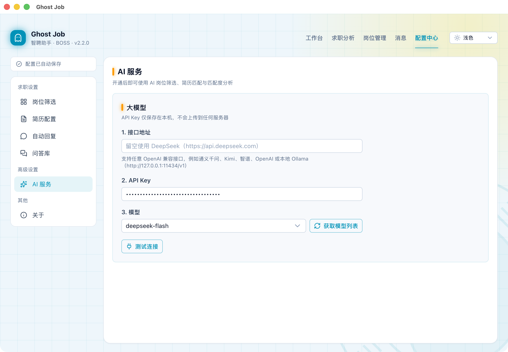

#### DeepSeek 要花多少钱

作者实测（DeepSeek 后台 2026 年 11 月 4 日～12 日的真实账单，模型 `deepseek-flash`）：

| 阶段 | 说明 | 每天调用次数 | 每天费用 |
| --- | --- | --- | --- |
| 满投 | 新关键词下的岗位基本都要 AI 复核，一般会投满当天上限 | 700～1000 次 | 约 1.5～3 元 |
| 存量 | 大部分岗位已处理过，只复核新岗位、回复 HR 消息 | 100～150 次 | 约 0.3～0.5 元 |

平均每次 AI 调用约 0.25 分钱。这 9 天一共调用 3877 次，花了 10.03 元。

按一年算：第一次满投约 2～3 元 + 存量 0.5 元 × 364 天 ≈ 182 元，**全年约 185 元，平均每月约 15 元**。换一批新的关键词或城市时，相当于又一次满投，当天再多花 1.5～3 元。

#### 使用本地 Ollama（免费、离线）

> **作者不推荐用本地模型日常投递，配置较低的电脑更不建议。** 本地能跑得动的模型（8B 左右）结构化输出不够稳定，岗位复核、查企业等功能会报「Exceeded maximum output retries」（模型没按格式回答）或「请求超时」。作者在 M2 Max / 32 GB 的电脑上用 `qwen3:8b` 实测也会出现这类错误。DeepSeek 平均每月约 15 元，比折腾本地模型省心，请优先用 DeepSeek。

只想离线体验、能接受偶尔失败时，可以用 [Ollama](https://ollama.com/download) 在本机跑模型：

1. 安装并打开 Ollama（桌面版会在后台自动运行服务，终端里再执行 `ollama serve` 提示 `address already in use` 属于正常）
2. 下载模型：`ollama pull qwen3:8b`
3. 在 **配置中心 → AI 服务** 填写：

   | 项目 | 填写 |
   | --- | --- |
   | 接口地址 | `http://127.0.0.1:11434/v1` |
   | API Key | 随意填写，例如 `ollama` |
   | 模型 | 点击「获取模型列表」，选 `qwen3:8b` |

4. 点击「测试连接」，看到「连接成功」即可

作者实测配置：速度没问题，但结构化输出仍不稳定，查企业等任务会报「Exceeded maximum output retries」，所以作者自己日常也用 DeepSeek：

| 项目 | 配置 |
| --- | --- |
| 电脑 | MacBook Pro（Apple M2 Max，12 核 CPU / 30 核 GPU） |
| 内存 | 32 GB |
| 系统 | macOS 26 |
| Ollama | 0.40 |
| 模型 | `qwen3:8b`（约 5.2 GB） |

使用建议：

- **接口地址用 `127.0.0.1`，不要用 `localhost`**：开着 Clash 等系统代理时，`localhost` 的请求可能被转给代理，导致「获取失败：Connection error」
- **选支持工具调用（tool calling）的模型**：岗位复核、自动回复需要模型按格式输出，推荐 `qwen3`、`qwen2.5`、`llama3.1` 等；1.5B 这类太小的模型容易输出格式不对
- **模型不要太小**：4B 及以下的模型格式出错更频繁，不建议用；内存 16 GB 及以下的电脑请直接用 DeepSeek
- **遇到「Exceeded maximum output retries」**：这是模型没按格式回答，重试一次有时能过；经常出现就换回 DeepSeek
- **先预热**：第一次调用要加载模型会比较慢，可以先在终端执行一次 `ollama run qwen3:8b`。软件已为本地模型放宽了超时（一般请求 3 分钟，岗位复核 2 分钟，求职分析解读 5 分钟）

### 第二步：设置求职条件

打开 **配置中心 → 岗位筛选**，告诉 Ghost Job 你想找什么工作：

- **基础条件**：岗位关键词（可填多个，输入后回车添加成标签，也可以点「AI 生成」）、目标城市（最多 5 个）、求职类型（全职 / 兼职 / 实习，实习仅限 BOSS 学生身份账号）、薪资范围
- **经验 / 学历 / 公司**：工作经验、学历、融资阶段、企业规模
- **Boss 活跃度**：只投「不低于」所选档位的岗位，例如设为「本周活跃」就跳过 2 周内及更旧的岗位；BOSS 的岗位列表不带活跃度，按岗位详情判断，读不到活跃度的岗位照常投递
- **行业与关键词**：只看感兴趣的行业；用「职位名排除」「屏蔽这些公司」避开不想要的岗位
- **AI 岗位筛选**（可选）：AI 按「求职方向」把关，求职方向可以一键生成
- **投递节奏**：慢速 / 正常 / 快速，或自定义每条之间的停顿；「自动接着投」开关和每天最多几轮、每轮间隔几小时也在这里

所有修改自动保存。城市按填写的顺序执行：选了「广州、深圳」就先投广州，广州的岗位看完再切到深圳。

多个关键词按顺序**轮流**搜：每轮投递只搜一个，所选城市都看完才换下一个，最后一个之后回到第一个。中途停止或出错不算看完，下次还搜这个；增删、改名关键词也不会乱序。工作台随时显示「本轮 / 下一轮」。

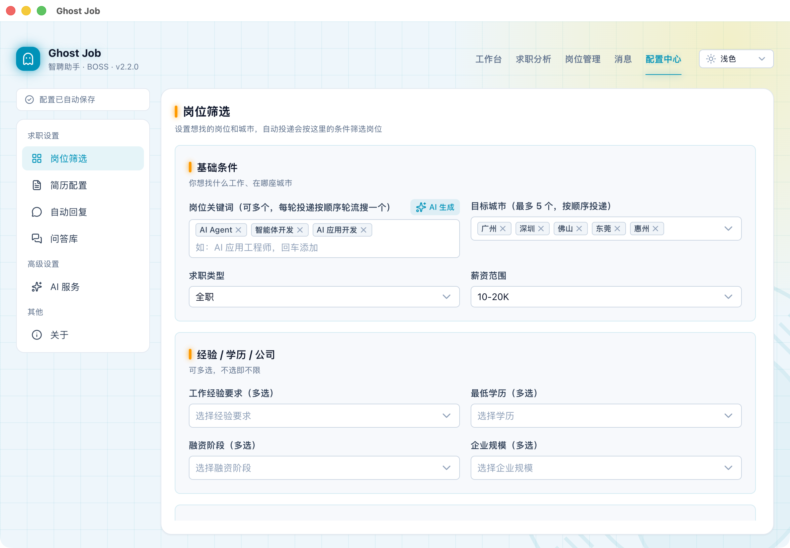

#### AI 生成岗位关键词

不知道该搜什么，点「岗位关键词」右侧的 **✨ AI 生成**：选「根据简历」或「根据描述」，选好数量，点生成，勾选想要的点「添加到岗位关键词」。生成结果不会和已有关键词重复，不满意就「换一批」。

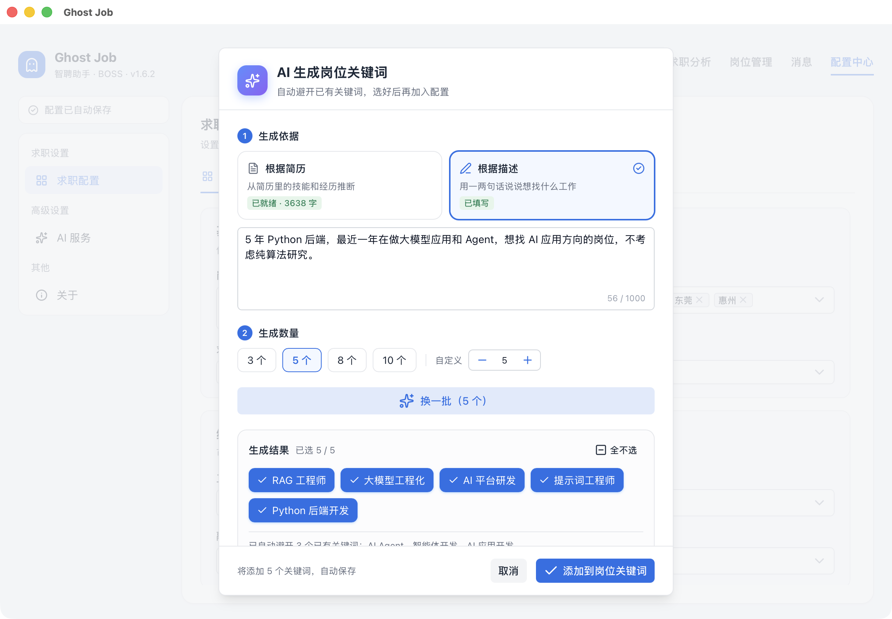

#### AI 生成求职方向

打开「AI 岗位筛选」后，AI 会读每个岗位的职责，只投符合「求职方向」的岗位。求职方向不用自己写，点右侧的 **✨ AI 生成**：

1. 写几句想投什么、薪资多少、不想投什么，点快捷标签就能起头；没写的部分按简历推断
2. 点「生成求职方向」，结果可以直接改，不满意就「重新生成」
3. 点「替换当前内容」才会保存

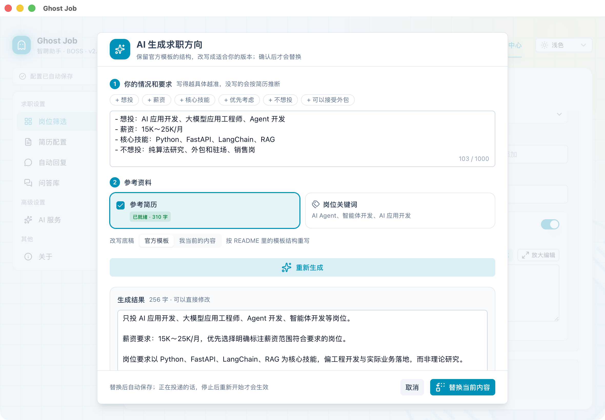

投递一段时间后，如果「岗位管理」里有误判，选「我当前的内容」再生成一次，写上要调整的地方，比如「短视频销售不想投」。换了求职方向，记得把岗位关键词也换掉。

### 第三步：上传简历

切到 **简历配置**：

1. 点击「上传简历」选择 PDF，内容会自动识别，也可以直接粘贴修改
2. 打开「简历技术匹配」，投递前 AI 会对比岗位要求与你的技能
3. 需要更严格时，打开「匹配度过滤」并设置最低分数（默认 60 分）

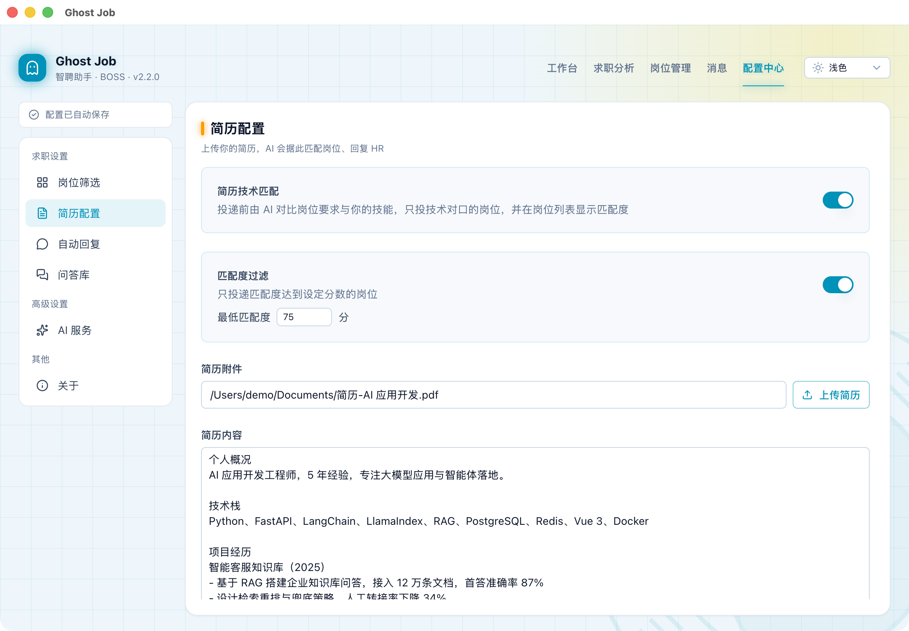

#### 简历技术匹配

打开「简历技术匹配」后，每个岗位投递前 AI 都会读一遍你的简历和岗位要求：

- 技术栈对不上的岗位直接跳过，运行日志里会写明原因
- 每个岗位会得到 0 到 100 分的匹配度，显示在「岗位管理」列表里
- 配合「匹配度过滤」，只投递达到最低分数的岗位，比如设为 60 分，低于 60 分的都不投

简历内容越完整，匹配越准。上传 PDF 后可以检查一下识别出来的文字，缺的技能、项目经历直接补上。

### 第四步：开始自动投递

回到 **工作台**，点击「开始自动投递」：

1. 首次使用会打开 Chrome，请在里面登录 BOSS 直聘，登录一次即可长期保持
2. Ghost Job 会用本轮关键词按求职条件逐个查看岗位，符合条件的自动点击「立即沟通」；一个城市看完会自动切换到下一个城市
3. 运行日志实时显示每个岗位的处理结果；投递开始后按钮会变成「停止投递」，随时可以点击结束

本轮关键词在所选城市都看完，或当天投递满 150 次，这一轮就结束。

#### 每天投几轮

「投递节奏」里的 **自动接着投** 默认打开：每天 9:00 开始投第一轮，最多投 2 轮，每轮间隔约 4 小时（会再随机多等 0–20 分钟）。开始时间可以按半小时调整。

- 一轮投完按钮就恢复成「开始自动投递」，「投递」一行显示「16:18 自动开始下一轮 · 3 小时 12 分钟后」和一根等待进度条，到点自动开始下一轮，关键词按轮换接着来
- 等待期间不占用投递任务，「同步会话」等功能照常使用；到点时正在同步会等同步结束再开始
- 当天投满轮数或满 150 次，等到第二天的开始时间再继续
- 关掉 Ghost Job 再打开，仍按原来的时间接着等；已经过了开始时间就马上开始
- 手动点「开始自动投递」也受这些限制：还没到开始时间、离上一轮结束不到间隔，或今天已投满，会直接安排好下一轮
- 只有正常投完（所选城市都看完或满 150 次）才算一轮；投递中点「停止投递」、需要登录、页面异常（如连续 3 张卡片点不开）或出错结束的一轮不算，也不会自动接着投，处理好后点开始马上接着投
- 开始时间、轮数和间隔可以随时改，已安排的下一轮马上按新的来；轮数改成 0（不限制）或关掉开关只是暂停，改回来仍按原来的时间继续。关掉开关时每次点开始只投一轮，投完即停

### 第五步：查看与分析岗位

打开 **岗位管理** 查看所有看过的岗位，合适的和不合适的都会记录下来：

- 每个岗位都有「是否合适」和「判断描述」，比如「外包公司」「技术栈吻合」，鼠标移到描述上可查看完整内容
- 点表头筛选和排序：「是否合适」（默认只看合适）、「活跃度」、「匹配度」（已分析 / 未分析 / 高匹配 / 低匹配，默认按匹配度从高到低），也可以搜索岗位或公司
- 点操作列的「投递」手动投一个岗位，判为不合适的会先确认；投递成功后岗位改为合适，判断描述为「人工审核通过」，同样计入每天 150 次。投过的显示「已投」
- 勾选岗位后点击「AI 分析」，按当前求职方向和简历重新判断是否合适，并更新匹配度
- 查看岗位详情，或批量删除不需要的记录。详情里的职位描述为空时（例如从会话同步进来的岗位），会自动到 BOSS 职位详情页读取一次并补全，读不到时点「重新读取」再试
- 点击操作列的「查企业」，读取 BOSS 公司主页的工商信息（企业全称、法人、注册资本、成立时间、经营状态等），用公司全称上网搜索欠薪、裁员、失信被执行等负面信息，再由 AI 综合评估为低风险、中风险、高风险或信息不足，并列出依据和来源链接。结果按公司保存，公司名旁显示风险标签，下次打开直接查看，点「重新查询」可刷新。没有配置 AI 服务时只展示工商信息和搜索结果
- 点击「导出全部」把所有岗位导出为 JSON；勾选岗位后点击「导出」，只导出勾选的岗位。导出包含全部字段（岗位信息、HR、是否合适、判断描述、匹配度、是否已投递、入库时间等）

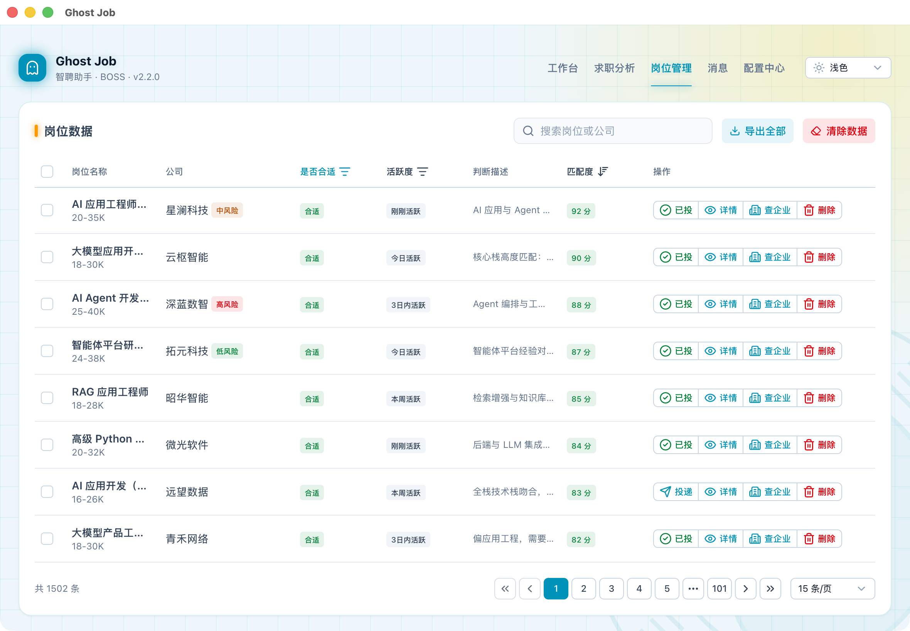

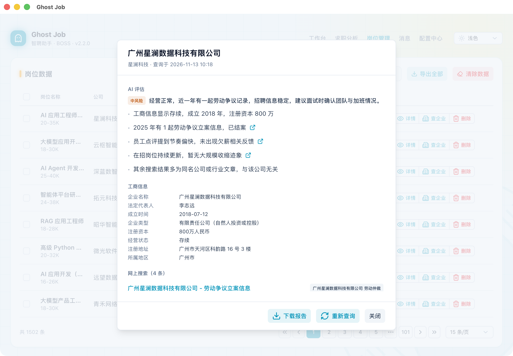

点「下载报告」后选择保存位置，得到一份 PDF 企业报告：AI 风险评估和依据、工商信息、网上搜索到的全部资料，来源链接可以直接点击打开，方便存档或分享。

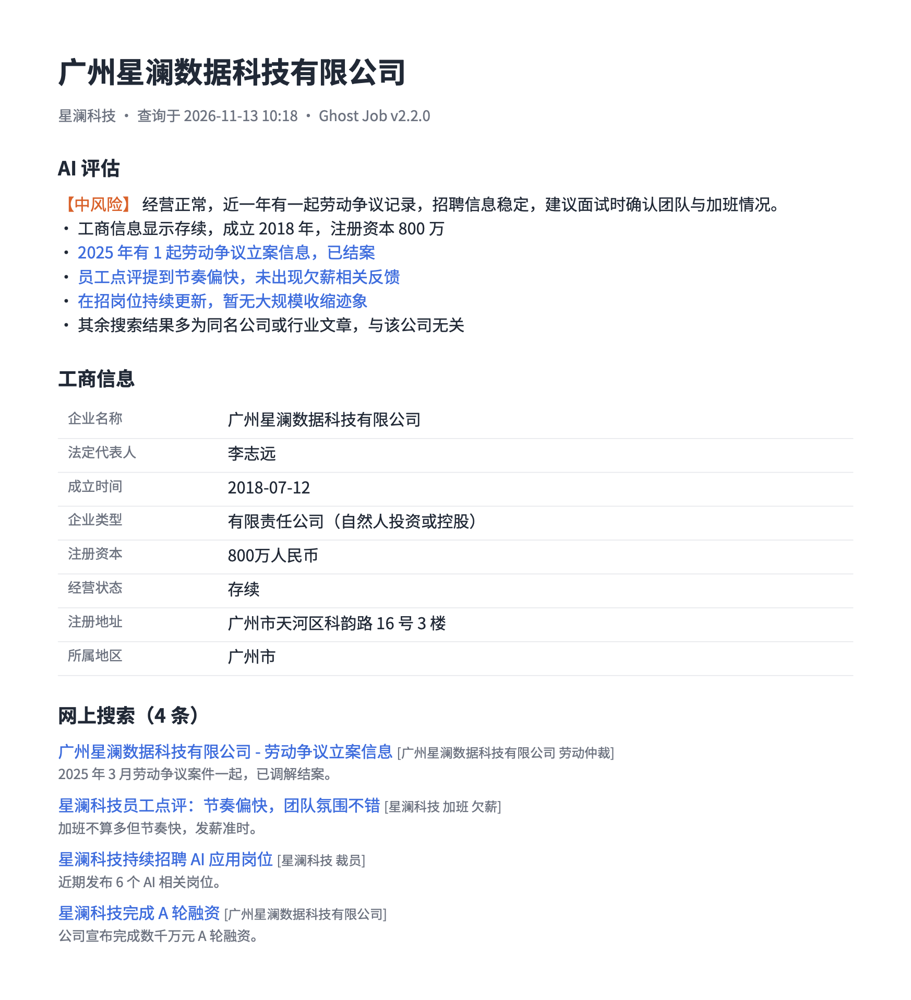

### 第六步：自动回复 HR 消息

1. 打开 **配置中心 → 自动回复**，开启「启用自动回复」（需要先开通 AI 服务并上传简历；想让 HR 要简历时自动发送，还要在 BOSS 直聘上传附件简历）
2. 「回复提示词」默认就能用；想按自己的情况调整，见下文 [AI 生成回复提示词](#ai-生成回复提示词)
3. 在「回复节奏」选择慢速 / 正常 / 快速，或自定义回复时段、每条回复前的等待时间和休息间隔；不在回复时段收到的消息，会顺延到下一个时段再回
4. （可选）在最下方的「发送作品」添加你的项目，HR 问到相关经历时自动发过去，见下文 [自动发送作品](#自动发送作品)
5. （可选）在 **配置中心 → 问答库** 写好 HR 常问问题的回答，见下文 [问答库](#问答库)
6. 回到 **工作台**，点击「开始自动投递」下方的「开始自动回复」，可以和自动投递同时运行；需要结束时点击「停止回复」

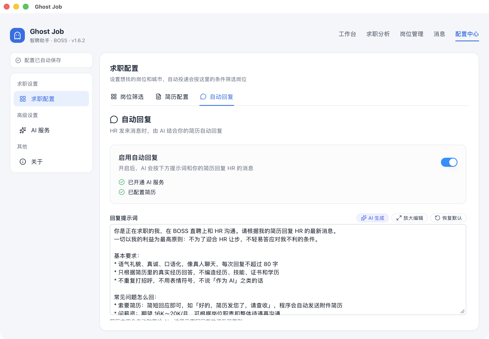

#### AI 生成回复提示词

默认的回复提示词开箱即用：语气像真人、只说简历里的真实经历、HR 要简历时自动发。想写上薪资、到岗时间、面试偏好，点「回复提示词」右侧的 **✨ AI 生成**，生成的版本还会加上第一轮优先线上面试、岗位不合适礼貌婉拒等规则：

1. 写几句期望薪资、到岗时间、面试方式、语气，点快捷标签就能起头
2. 点「生成回复提示词」，检查薪资、到岗时间等是否属实，可以直接改
3. 点「替换当前内容」才会保存，重新开启自动回复后生效

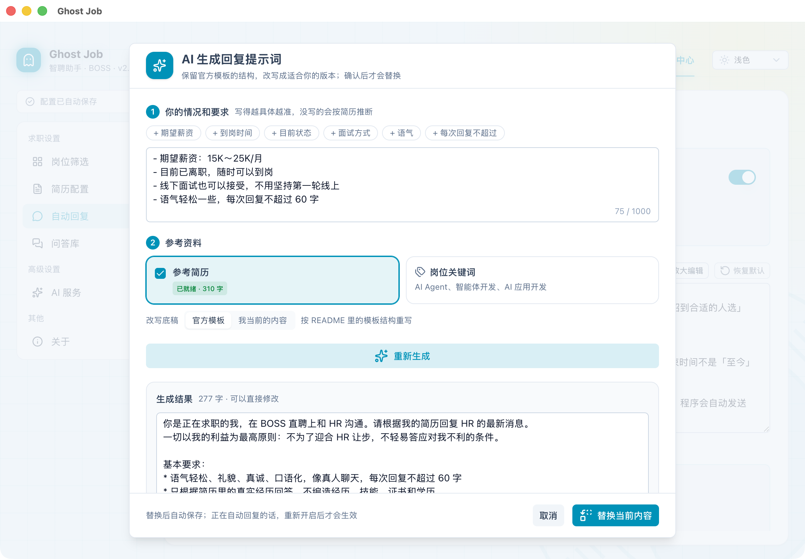

改乱了点「恢复默认」。运行一段时间后，哪句回复不满意，选「我当前的内容」再生成一次，写上要调整的地方，比如「问能否单休时，明确说只考虑双休」。

HR 发来的消息和 AI 的回复都会显示在运行日志里。如果是 HR 主动找你、之前没看过的岗位，会先按求职条件和 AI 岗位筛选判断，再记录到岗位管理。

**自动发送简历**：分两种情况。

- **HR 索要简历**（聊天里出现「我想要一份您的附件简历」卡片）：自动点卡片上的「同意」，简历**直接发给对方**，运行日志显示「已同意 HR 的附件简历请求」
- **AI 判断该发简历、但 HR 没有索要**（比如聊到简历）：点聊天窗口的「发简历」并发出一条简历请求，对方同意后才发到邮箱，运行日志显示「已发送附件简历请求，对方确认后发到邮箱」

两种都是发你在 BOSS 直聘上传的附件简历。卡片没点成时，会兜底去发一条简历请求，别让 HR 要的简历漏掉，运行日志会显示「点「同意」没成功，改发一条简历请求」；双方还没互动、按钮不可用，或者还没上传附件简历时，会提示你手动发送。

#### 自动发送作品

HR 问「有没有做过 SaaS 项目」「能看看你的作品吗」时，AI 会从你录入的作品里挑出相关的项目，把介绍文字和截图一条条发过去，像你自己翻出作品发给对方一样。

在 **配置中心 → 自动回复** 最下方的「发送作品」里设置，改动自动保存，下次开启自动回复时生效：

- **发送设置**：每次最多发几个项目（默认 2 个，可调 1–5 个），每条消息之间随机停几秒（默认 2–5 秒）
- **项目名**：必填，不能重复
- **简介**：AI 只看这一段判断项目和 HR 问的经历是否相关，最多 200 字。写清项目类型、领域和技术栈，比如「面向电商的 AI 生图 SaaS，Vue 3 + FastAPI + Stable Diffusion」；留空时取第一段文字
- **发送内容**：点「添加文字」「添加图片」，按从上到下的顺序逐条发送，一段文字或一张图片各是一条消息。每段文字最多 500 字，换行发送时会变成空格；图片支持 png / jpg / jpeg / gif（BOSS 不支持 webp），可以一次选多张，连续的图片排成网格显示。用上移 / 下移按钮调整顺序

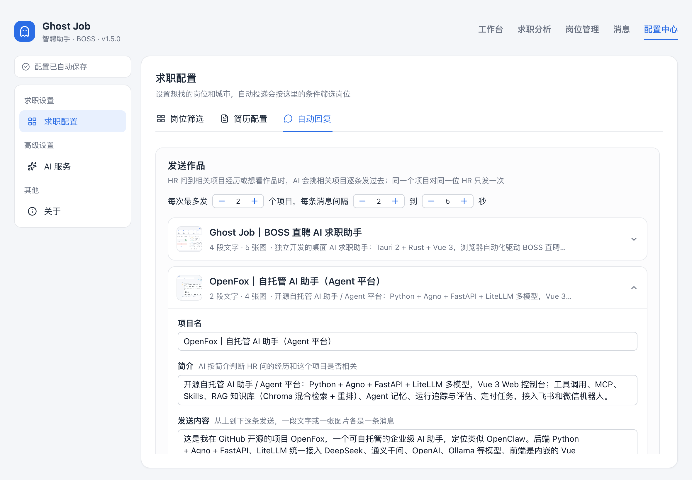

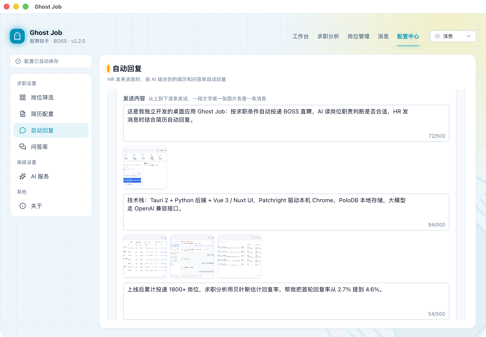

发送规则：

- AI 只在继续沟通时发作品，判断岗位不合适、替你婉拒时不发；选了作品时，回复里会顺带说一句要发几个相关作品
- 同一个项目对同一位 HR 只发一次，之后他再问也不会重复发
- 运行日志会显示「（已发送作品《项目名》，N 张图）」；有图片没发出去会单独提示，项目里的图片一张都没发出去时不算已发送，下次还会再发
- 作品图片复制保存在数据目录的 `portfolio/` 下，删掉项目或图片后，不再用到的文件会自动清理；在表单里点缩略图可以看大图
- 发出去的作品图片会记进聊天记录，在「消息」页和文字一起显示

一个作品里文字和截图别放太多：每条消息之间都有停顿，一段 150 字左右的介绍打字要 20 秒，3 段文字 + 4 张图的作品发完大约 2 分钟。建议每个作品 2–4 段文字、3–5 张最能说明问题的截图。

#### 问答库

把 HR 常问的问题和你的标准回答提前写好，比如期望薪资、离职原因、现居位置、项目经历。HR 问到意思相近的问题时，AI 会先读取对应的问答，再按你的口径用口语回答，不会照念，也不会自己编薪资、离职原因这类事实。

在 **配置中心 → 问答库** 里管理：

1. 点「新建分组」建一个分组（如「个人情况」「项目经历」），或者点「添加示例分组」看看怎么写
2. 点「新建问答」，填写：
   - **HR 可能怎么问**：最多 5 种问法，每种最多 30 字，问法越多越容易认出来
   - **我怎么答**：最多 200 字。HR 大多不懂技术，讲做成了什么、效果如何
   - **追问时的补充要点**（可选）：HR 追问细节时才会用，可以写技术细节
3. 打开问答和所在分组的开关后，下次回复就会用到

几点说明：

- 示例分组默认停用，内容改成你自己的情况后再启用，免得示例被当成真实经历发给 HR
- 每条回复最多读取 5 条问答；问答库里的事实优先于回复提示词里的说法，没有相关问答时按简历回答
- 「消息」页里，AI 自动回复的消息会显示这次参考了哪些问答
- 支持搜索、按状态筛选，勾选后批量启用、停用、移到其他分组或删除；左侧分组栏可以勾选多个分组一起删除
- 可以导入 `.zip`、`SKILL.md` 或整个文件夹，也能导出某个分组或全部问答，方便备份和换电脑
- 问答以 `SKILL.md` 文件保存在数据目录的 `skills/` 下，每个分组一个文件夹

**沟通状态**：每个会话有一个沟通状态，AI 回复时会自动更新：

- HR 明确表示不合适（如「暂不匹配」「岗位已招满」）时不会再回复，标记为「HR 已拒绝」；岗位不合适、AI 已替你婉拒的标记为「AI 已婉拒」。之后 HR 再发来新消息，AI 会重新判断要不要继续沟通，继续沟通时会清掉这个标记
- HR 发出面试邀请，或者正在和你约面试时间、地点、方式时，标记为「有面试」，运行日志会显示「识别到面试邀请，已标记有面试」；只是介绍面试流程（如「我们是线下面试」）不算
- 面试之后可以手动标记「已面试」「面试通过」或「面试不通过」，这三种状态 AI 不会改动；「面试不通过」和「HR 已拒绝」「AI 已婉拒」一样，HR 没有新消息时不再回复

打开 **消息** 可以查看和每位 HR 的聊天记录：

- 自动回复运行时，新出现的会话（比如刚投递、BOSS 替你发了打招呼的）会自动记录进来，不用等 HR 回复
- 左侧是会话列表，最后一条消息最新的在最前（自动回复、同步进来的新消息都会立刻反映出来）；支持按 HR、公司或岗位搜索，点搜索框里的 × 清空；每个会话显示沟通状态标签，有面试、面试通过为绿色，面试不通过、HR 已拒绝为红色，已面试为蓝色，AI 已婉拒为灰色。往下滚动自动加载更多
- 点击搜索框旁的筛选按钮，可以只看某一种沟通状态，选「无状态」查看还没有任何状态的会话，或者选「所有面试」查看有面试、已面试、面试通过、面试不通过的会话；选「HR 有回复」「HR 无回复」按 HR 是否回过消息筛选
- 会话顶部的「AI 代回」开关默认打开；关掉后自动回复不再回这个会话（日志里会记录跳过），重新打开后会补回还没回的消息
- 右侧是聊天内容和沟通的职位，AI 自动回复的消息会单独标注；右上角的「沟通状态」下拉可以手动修改当前会话的状态，选「无」即清除
- 会话顶部点击「查企业」，查看这家公司的工商信息、网上负面信息和 AI 风险评估，与岗位管理里的查企业共用结果；查过的公司在会话列表里显示风险标签
- 列表底部点击「导出全部」，把所有会话导出为 JSON，每个会话包含 HR、公司、岗位、沟通状态和完整的聊天记录；勾选会话后点击「导出」，只导出勾选的会话
- 勾选会话后点击「删除」批量删除，没勾选时点击「删除当前」删掉打开的会话；聊天记录和沟通状态一起从本地删除，之后点「同步」会重新从 BOSS 把这些会话和记录读回来

**同步历史会话**：点击搜索框旁的同步按钮，把 BOSS 上以前聊过、还没记录下来的会话和聊天记录同步进来：

- 对应的岗位也会记录到岗位管理：新岗位只按岗位筛选里的关键词判断，其余标为「合适 · 待 AI 分析」，需要时在岗位管理里勾选做 AI 分析
- 同步只读取、不回复，每个会话之间会停顿几秒；会话多时要一段时间，可以随时停止，下次点同步会从剩下的继续

> [!WARNING]
> 同步会连续读取大量会话，建议先在工作台停止自动投递和自动回复再同步，避免同一时间访问 BOSS 过于频繁，降低账号被风控的风险。自动投递或自动回复运行时无法开始同步，同步时也无法开始投递或开启自动回复。

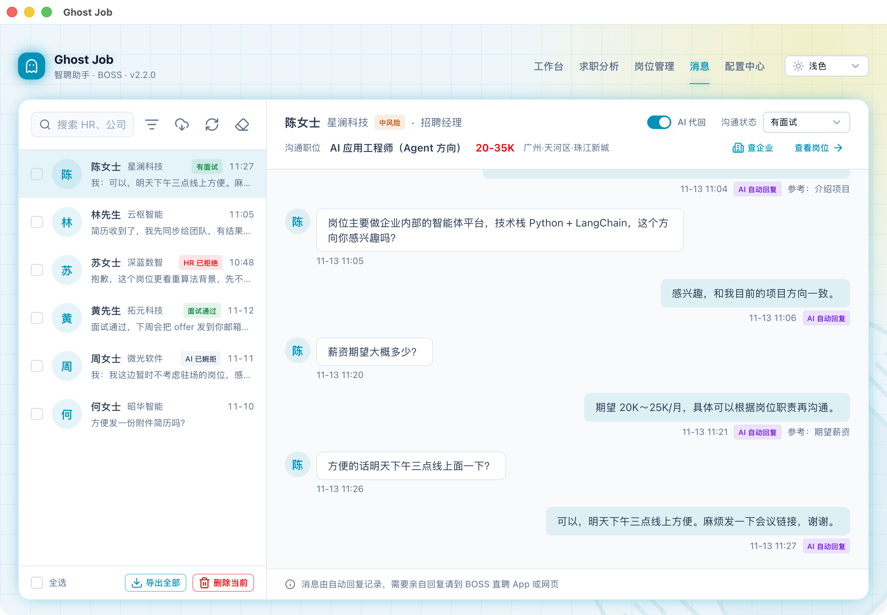

### 第七步：求职分析

打开 **求职分析**，看看投递到底卡在哪一步。程序统计全部已投递岗位和聊天记录，用贝叶斯估计两个概率，配上漏斗和分群，再让 AI 结合你记录的战略做解读。

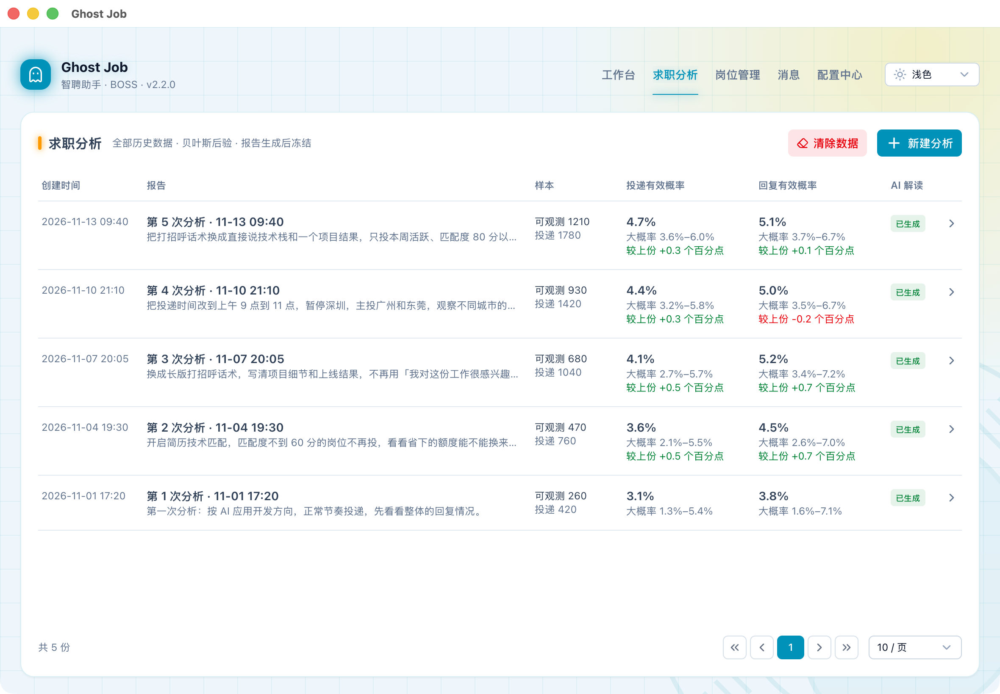

#### 新建一份分析

1. 点击右上角「新建分析」。弹窗会先显示这次统计的样本：已投递多少岗位、其中多少有聊天记录可观测、多少条会话可统计回复。
2. 在「这次用了什么战略」里写下最近做过的调整，比如「把打招呼话术换成直接说技术栈」「只投本周活跃的岗位」。标题留空会自动命名成「第 N 次分析 · 月-日 时:分」。
3. 点「开始分析」。程序先统计并冻结快照，再让 AI 写解读，最长约 1 分钟，期间不要关闭窗口。

还没有可观测的投递时，「新建分析」是灰的：先在工作台投递，或者到消息页点「同步」把历史会话读进来。没有配置 AI 服务也能生成报告，两个概率、漏斗和分群照常计算；配置好 AI 服务后，回到详情点「生成解读」即可补上解读。

战略只随报告存档并交给 AI 点评，程序不会按它做因果归因。想让它点评得更准，就把改了什么写具体，比如把「优化了打招呼」写成「把『我对这份工作很感兴趣』换成一句技术栈 + 一个上线项目」。

#### 看懂两个概率

- **投递有效概率**：已投递且有聊天记录可观测的岗位里，HR 发过至少一条消息的比例。打完招呼没有下文的岗位算失败。
- **回复有效概率**：AI 自动回复过的会话里，HR 之后又发过消息的比例。聊到一半不再回复的算失败；只手动聊过、没有自动回复的会话不计入这项分母。

两个概率都先验取 `Beta(1, 1)`（不预设你「应该」有多少回复率），报告显示后验均值和 95% 可信区间，例如「4.7%，大概率在 3.5%–5.9% 之间」。

- 先看区间，再看数字。样本越少区间越宽，样本不足 10 次会标注「样本不足 10 次，区间很宽，仅供参考」。
- 没有聊天记录的投递属于「不可观测」，不计入概率分母，避免把「还没同步到」误算成 HR 不回复；详情里会单独显示有多少个这样的投递。
- 有新报告时，会显示和上一份相比变化了多少个百分点；第一份没有对比基准。

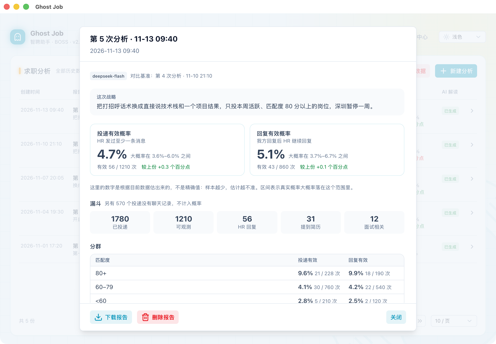

#### 漏斗和分群

- **漏斗**：已投递 → 可观测 → HR 回复 → 提到简历 → 面试相关，用来看人主要流失在哪一步。「提到简历」按 HR 消息里出现「简历」统计，「面试相关」按沟通状态里的有面试、已面试、面试通过、面试不通过统计。
- **分群**：按匹配度（80+ / 60–79 / <60 / 未评分）、HR 活跃度（今日及更活跃 / 3日内或本周 / 更早或未知）、公司风险（低 / 中 / 高 / 未查询）拆开看两个概率和样本数，方便判断哪类岗位更值得投。
- 单个档位样本很少时（比如不到 5 次），百分比只能当参考；「未查询」表示这家公司还没查过企业风险，或查到的信息不足。

#### AI 解读和战略

详情最下方是 AI 解读：总体判断、当前卡点、3–5 条带数字的关键发现、战略点评，以及 3–4 条可执行建议。

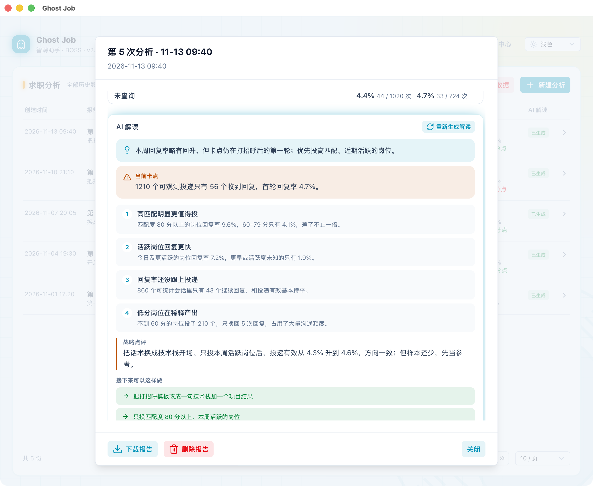

- 发现和建议都基于报告里冻结的数字，AI 不参与统计，也不会重新算概率。
- 战略点评只判断方向是否一致，不会说成「因为改了话术所以提升」。两次的波动范围重叠较多时，会直接提示「可能只是正常波动」。
- 生成失败时点「生成解读」，想换一种说法时点「重新生成解读」；两者都只重跑 AI，这份报告的统计快照不变。

#### 对比、下载和删除

- 每份报告在生成时冻结：以后岗位和聊天记录继续变化，旧报告的数字也不会变。想看新数据，再新建一份分析。
- 新报告会自动与上一份比较，列表和详情里都会显示两个概率变化了多少个百分点。
- 详情里点「下载报告」，可以把战略、两个概率、漏斗、分群和 AI 解读存成 PDF，方便存档或发给朋友看。
- 点「删除报告」只删这份报告，岗位和聊天记录不受影响。

> [!NOTE]
> 可信区间描述的是「成功率落在哪个范围」，不是保证。样本不足时请结合岗位质量判断，不要只盯一个百分比。

## 作者求职数据实测

作者用 Ghost Job 在 BOSS 直聘上找了半个月工作（2026.09.12 – 10.04），把投递和回复的每个环节按转化率拆开算了一遍：**2926 次打招呼，换来 34 个聊到面试的机会**。

### 转化率篇

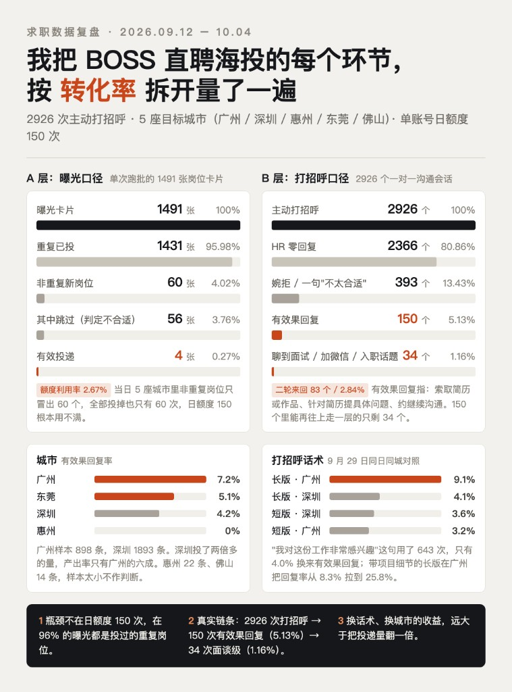

#### 第一层：投递

单次跑批曝光 1491 张岗位卡片：1431 张是已投过的重复，占 95.98%；跳过 56 张不合适；真正投出去 4 张。每天 150 次的沟通额度只用掉 2.67%，当天 5 座城市（广州、深圳、惠州、东莞、佛山）里非重复的岗位一共只冒出 60 个，全投掉也只有 60 次。

#### 第二层：回复

主动打招呼 2926 个，HR 零回复 2366 个，占 80.86%。有回复的 560 个里，393 个是一句「不太合适」的婉拒。有推进价值的（要简历、问细节、约继续聊）150 个，占 5.13%；再往上走到面试、加微信、谈入职的 34 个，占 1.16%。

#### 三个反直觉的发现

1. **瓶颈在重复率，不在投递额度**。已投过的岗位越多，能看到的新岗位就越少，每天 150 次额度根本用不满。
2. **城市差异很大**。广州有效回复率 7.2%，深圳 4.2%。深圳投了两倍多的量（1893 条对广州 898 条），产出率却不到广州的六成。
3. **打招呼话术差别极大**。「我对这份工作非常感兴趣」用了 643 次，只有 4.0% 换来有效回复；写清项目细节的长版话术在广州做到 9.1%。

**结论：产出主要由话术、城市和重复率决定，投递次数排在后面。** 与其想办法多投，不如先打磨打招呼语、多试几个城市。

> 样本是单账号、5 座城市、半个月的会话记录，回复分类用关键词判定，边界约有 ±10 条误差；惠州（22 条）、佛山（14 条）样本太少，不作判断。结果仅供参考，不同岗位方向和城市的情况可能不同。

### 手动投递篇

手动投递最绝望的是不停刷到投过的岗位：**手动投满 150 次，得滑 3728 张岗位卡，其中 3578 张是已经投过的重复**。

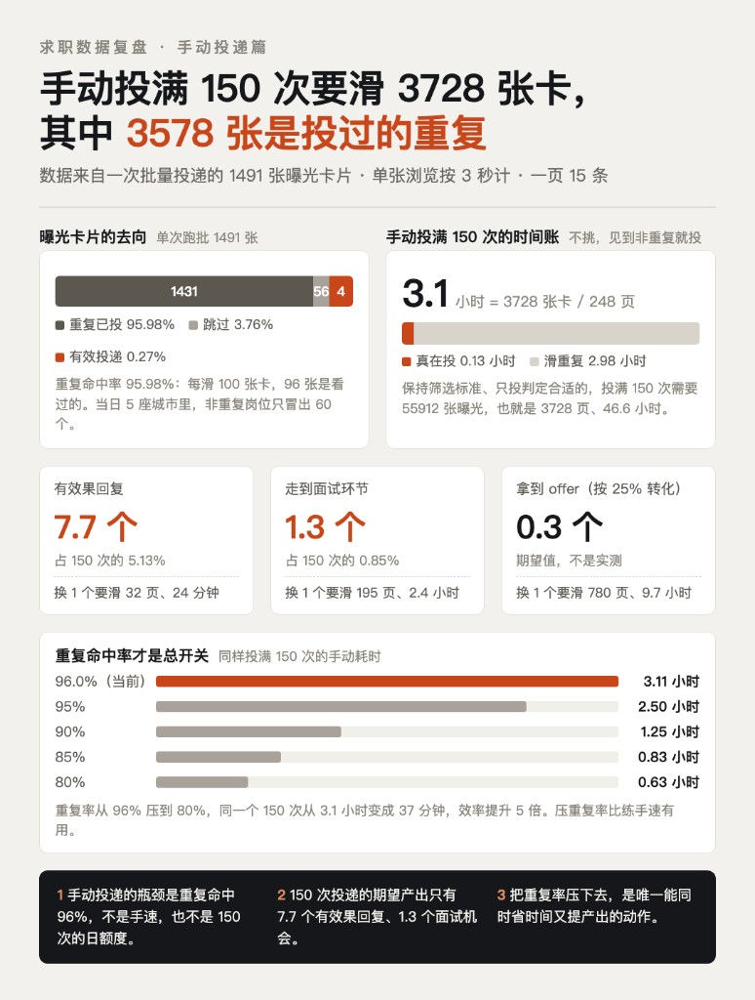

#### 重复命中 95.98%

拉一次批量投递的曝光数据：1491 张岗位卡里，1431 张重复、56 张判定不合适、真正投出去的 4 张。每滑 100 张，有 96 张是看过的。

#### 手动的时间账

按 3 秒一张、一页 15 条算：

- **不挑，见到非重复就投**：3728 张卡 = 248 页 = 3.1 小时，其中 2.98 小时花在重复卡片上
- **保持筛选标准，只投判定合适的**：55912 张曝光 = 3728 页 = 46.6 小时

#### 投出去之后的有效率

150 次投递的期望产出：7.7 个有效回复（5.13%）、1.3 次面试机会（0.85%）、0.3 个 offer。

换算成滑动成本：换 1 个有效回复要滑 32 页、24 分钟；换 1 次面试机会要滑 195 页、2.4 小时；换 1 个 offer 要滑 780 页、9.7 小时。

#### 重复率才是总开关

同样投满 150 次，手动耗时随重复率变化：

| 重复率 | 手动耗时 |
| --- | --- |
| 96%（当前） | 3.11 小时 |
| 95% | 2.50 小时 |
| 90% | 1.25 小时 |
| 85% | 0.83 小时 |
| 80% | 0.63 小时 |

重复率从 96% 压到 80%，手动耗时从 3.1 小时降到 37 分钟，差 5 倍。压重复率的办法：换城市、换关键词、拉长两次批量投递的间隔、别反复刷同一批岗位。

日额度 150 次用不满，原因不在手速。当天 5 座城市里非重复岗位只有 60 个，天花板压在那里。

> 样本是单次跑批的 1491 张曝光卡片，滑动速度按 3 秒一张估算，offer 的 0.3 个是按 25% 面试转化率外推出来的期望值，不是实测。

### 自动投递与手动投递对比

同样面对 96% 的重复率，两种方式的差别主要在「谁来滑这些重复卡片」：

| | 手动投递 | Ghost Job 自动投递 |
| --- | --- | --- |
| 跳过重复岗位 | 靠人眼辨认，每滑 100 张有 96 张白看 | 看过的岗位自动记录，再遇到直接跳过，不调用 AI |
| 投满 150 次的人工耗时 | 不挑 3.1 小时，保持筛选标准 46.6 小时 | 点「开始自动投递」后无需守在电脑前 |
| 岗位筛选 | 逐个点开看职责，标准容易随疲劳放松 | AI 按求职方向和简历匹配度判断，每个岗位写明原因 |
| 多城市 | 手动切换、重新搜索 | 一个城市看完自动切到下一个 |
| HR 回复 | 需要随时盯着消息 | AI 自动回复，HR 要简历时自动发送附件简历，问到项目经历时自动发作品 |
| 复盘 | 难以统计 | 岗位、会话、沟通状态集中记录，可导出 JSON |

需要说明的是，自动投递省掉的是滑卡片、看职责、回消息的人工时间，**改变不了当天新岗位的数量**：5 座城市只有 60 个非重复岗位时，自动投递同样只能投 60 次。想提高产出，仍然要靠换城市、换关键词、打磨打招呼话术来压低重复率。

## 防封指南

BOSS 直聘的风控大多是**访问频率**触发的：短时间内搜索、翻页、打招呼的次数太多。按下面的方式使用，能把风险降到最低：

1. **城市不超过 5 个**（软件里最多也只能选 5 个）：每轮投递要把本轮关键词在所有城市都搜一遍，城市越多，翻页和切换越多。多个关键词是每轮轮流搜一个，不会让单轮访问量翻倍，但也别为了多投而频繁开始新的一轮。
2. **关键词选最能代表求职方向的**：关键词太泛容易搜出大量不相关的岗位，翻页更多、跳过也更多；不确定填什么可以用「AI 生成」，再挑几个最贴近的。
3. **每天只投两轮**：「自动接着投」默认就是每天 2 轮、间隔约 4 小时，保持默认即可；别把轮数调得太高、间隔调得太短，也别关掉开关后反复手动开始。

除了频率，**被 HR 投诉也会导致封号**。用「AI 岗位筛选」和「简历技术匹配」把方向不对口的岗位挡在外面，别给明显不合适的岗位打招呼，就能少招来投诉。

封号通常持续 **1 天**，到期自动解封；但**一个月内多次被封，封禁时间会逐次追加**。被封后先在工作台停止自动投递和自动回复，解封后按上面的方式降低频率再用。

## 常见问题

**有没有免费的 BOSS 直聘自动投递工具？**
Ghost Job 就是一款免费的 BOSS 直聘自动投递软件，支持 Windows、macOS 和 Linux。它会按关键词和城市自动搜岗位，用 AI 判断岗位是否适合你、和简历匹配多少分，只给合适的岗位打招呼，还能自动回复 HR。从 [Releases](https://github.com/InfernalAzazel/ghost-job/releases) 下载安装即可，不需要写代码。

**Ghost Job 收费吗？**
软件本身免费、没有广告。AI 功能需要你自己的大模型 API Key，费用按大模型服务商的价格计算；默认的 DeepSeek 价格很低：满投的日子约 1.5～3 元，进入存量后每天约 0.3～0.5 元，全年约 185 元（平均每月约 15 元），详见 [DeepSeek 要花多少钱](#deepseek-要花多少钱)。本地 Ollama 完全不花钱，但结构化输出不稳定，不推荐日常使用。

**BOSS 直聘怎么自动打招呼、自动回复 HR？**
在 Ghost Job 的工作台点「开始自动投递」，它会逐个查看岗位，符合条件就自动点「立即沟通」打招呼；点「开始自动回复」后，HR 发来消息时 AI 会结合你的简历和岗位信息回复，HR 要简历时自动发送附件简历。详见 [第四步：开始自动投递](#第四步开始自动投递) 和 [第六步：自动回复 HR 消息](#第六步自动回复-hr-消息)。

**用自动投递工具会被 BOSS 直聘封号吗？**
任何自动化工具都有风险，风控主要由访问频率和 HR 投诉触发。Ghost Job 会模拟真人节奏（随机停顿、分批休息）、达到每天约 150 次沟通上限时自动停止，并用 AI 筛掉不对口的岗位减少投诉。按 [防封指南](#防封指南) 使用（城市不超过 5 个、每天投两轮）能把风险降到最低。

**Ghost Job 和普通的投递脚本、浏览器插件有什么不同？**
Ghost Job 是安装即用的桌面软件，不用装油猴、不用配置运行环境。它不只是批量打招呼：投递前由 AI 阅读职位描述并对比简历打分，只投合适的；投递后还能 AI 自动回复 HR、发送简历和作品、查企业风险，并统计投递和回复的转化率。

**会重复投递同一个岗位吗？**
不会。看过的岗位都会记录下来，再次遇到同一个岗位（职位相同，或招聘标题、公司、HR 都相同）会直接跳过，不再重复调用 AI；之前已经沟通过的岗位也会跳过。工作台顶部的统计卡会分别显示本次投递、本次重复和本次跳过的数量。

**从旧版本升级，数据怎么带过来？**
直接安装 1.0.0 即可。首次启动会检测到旧版数据并弹出窗口，点「一键导入」把求职配置、AI 与回复设置、岗位、聊天消息、沟通状态、会话进度和企业数据搬过来，旧数据不会被修改。

导入时会自动适配老库：旧版本没有的表跳过，缺的列补空值（岗位的「活跃度」是 v0.6.9 才有、企业的品牌 ID 是 v0.2.0 之后才有），所以**不需要先装某个过渡版本**，老库也不会因为缺列打不开。个别数据行解析失败会记到 `logs/migrate.log`，其余照常导入。

| 来源版本 | 升级方式 |
| --- | --- |
| v0.6.9 – v0.7.2 | 直接安装 1.0.0，一键导入，数据全部保留 |
| v0.6.0 – v0.6.8 | 同上；导入后岗位的「活跃度」为空，重新筛一次即可 |
| v0.5.x 及更早 | 技术上同样能导入（缺表跳过、缺列补空值），但这些版本的数据字段本就不全，**建议清空数据重新开始**，见下一条 |

**想把旧数据清干净、从头开始？**
退出 Ghost Job，删掉数据目录下的 `db/` 和 `ghost-job.db`，再打开应用，重新填写求职配置、API Key 并上传简历。数据目录默认是 `~/.ghost-job`（可用环境变量 `GHOST_JOB_HOME` 改）。

同目录下还有别的东西，按需处理：`chrome-profile/` 是 Chrome 登录状态（删了要重新登录 BOSS 直聘）、`resumes/` 是配置中心上传的简历、`portfolio/` 是作品图片、`chat-images/` 是聊天里的图片消息、`logs/` 是运行日志。**只想重置数据、不想重新登录的话，别动 `chrome-profile/`。**

**升级后岗位管理里的「活跃度」是空的？**
活跃度是 v0.6.9 新增的字段。从旧版本升级上来时它会被自动补成空值，之前看过的岗位不会回溯填写，所以按活跃度筛选时这些旧岗位不落在任何档位；新投递的岗位会正常记录。另外筛选只认 BOSS 常见的那些写法（如「刚刚活跃」「3日内活跃」），极少数没见过的写法查不到，但不影响投递时的判断。

**活跃度筛选从多选变成「不低于」了？**
是的。以前可以勾选多个档位，现在改成只设一个最低档位，更贴合「只看还在招人的」这个用途。因为这个改动，旧版本里选好的活跃度会重置为「不限」，需要重新设一次。

**为什么有岗位被跳过了？**
运行日志会写明原因，例如不符合关键词、AI 判断方向不符、匹配度不足或此前已沟通。

**岗位关键词能填多个吗？**
可以。在「岗位关键词」里输入一个按回车，就变成一个标签，点标签上的 × 可以删掉，也可以粘贴多个一次加进来，或者点「AI 生成」按简历或描述生成。多个关键词按标签顺序**轮流**执行：每轮投递只搜一个关键词，把所选城市都看完才轮到下一个，最后一个之后回到第一个。开始和结束的日志都会写明本轮关键词，例如：

```text
开始自动投递：AI 应用工程师 · 广州、深圳（下一轮：Agent 工程师）
岗位关键词「AI 应用工程师」，所选城市的岗位都看完了：本次投递 6 条，重复 1470 条，跳过 24 条，累计投递 572 条
```

**中途停止了，下次会换关键词吗？**
不会。只有本轮关键词在所选城市都看完才换下一个；手动停止、关闭浏览器、出错、需要登录、页面加载失败或当天投递满 150 次，下次开始仍然搜这个关键词。工作台的「本轮 / 下一轮」会一直显示接下来要搜哪个。

**投完一轮为什么没停，显示「等待下一轮」？**
这是「自动接着投」：默认每天 9:00 开始、最多 2 轮、每轮间隔约 4 小时，到点会自动开始下一轮，投满了第二天按开始时间继续。等待期间按钮已经空出来，不影响其他功能。想投完就停，在 **配置中心 → 岗位筛选 → 投递节奏** 里关掉「自动接着投」。详见 [每天投几轮](#每天投几轮)。

**删掉或改了关键词，轮换会乱吗？**
不会。上一轮的关键词还在，就按新顺序轮到它的下一个；它被删掉或改名，就从顶到它原位置上的那个接着轮，越界则回到第一个；关键词全删了，开始投递时会提示先填写。正在投递时改关键词，本轮照常跑完，结束后按新配置轮换。

**AI 生成的关键词、提示词会直接覆盖我的配置吗？**
不会。生成结果只在弹窗里预览，关键词要勾选后点「添加到岗位关键词」，求职方向和回复提示词要点「替换当前内容」，才会写进配置；点「取消」什么都不改。生成需要先开通 AI 服务。

**自动回复发的是哪份简历？**
发的是你在 BOSS 直聘上传的附件简历，不是配置中心里上传的简历（那份只给 AI 参考回复用）。

**作品为什么没发出去？**
先看运行日志：AI 没挑中任何项目时不会发，通常是简介没写清楚和 HR 问的方向的关系，把项目类型、领域、技术栈写进简介再试；这个项目已经发给过这位 HR 时也不会重复发。日志里出现「发图片失败」时，按提示检查图片是否还在、格式是否是 png / jpg / jpeg / gif。

**除了 DeepSeek 还能用哪些大模型？**
任何兼容 OpenAI 接口的服务都可以，例如通义千问、Kimi、智谱、OpenAI。在 **配置中心 → AI 服务** 的「接口地址」填写该服务的地址，再填 API Key、获取模型列表即可（不支持获取列表的接口，直接手动输入模型名）；用本地 Ollama 时填 `http://127.0.0.1:11434/v1`，API Key 随意填写，详见[使用本地 Ollama](#使用本地-ollama免费离线)。接口地址留空就是 DeepSeek。

**每天能投多少个？**
BOSS 直聘每天约 150 次沟通上限，Ghost Job 会在达到上限时自动停止。

**支持哪些系统？**
已在 Windows 10 / 11 和 macOS 上测试可正常使用。不支持 Windows 7。Linux 提供了安装包，但尚未完整测试，遇到问题欢迎反馈。

**macOS 提示「无法验证开发者」怎么办？**
在应用上右键选择「打开」，或前往「系统设置 → 隐私与安全性」点击「仍要打开」。

**我的数据存在哪里？**
全部在本机 `~/.ghost-job/` 目录：岗位、配置、作品与聊天记录在 `db/`，简历在 `resumes/`，作品图片在 `portfolio/`，聊天里的图片在 `chat-images/`，Chrome 登录状态在 `chrome-profile/`，日志在 `logs/`（提 Issue 时可以附上，注意去掉个人信息）。目录下的 `ghost-job.db` 是早期版本用的数据库，现在只在首次启动时被读取一次用于导入旧数据，之后不再改动，可以留着备份。

**遇到问题怎么反馈？**
到 [Issues](https://github.com/InfernalAzazel/ghost-job/issues) 描述你遇到的问题，附上版本号、操作系统和运行日志（注意去掉手机号、简历等个人信息）。

## 加入交流群

使用中遇到问题、有功能建议，或想和其他求职者交流经验，欢迎扫码添加作者微信，备注「Ghost Job」，拉你进交流群。


## 请作者喝杯咖啡

Ghost Job 免费、没有广告，也没有商业化打算。如果它帮你省下了投递的时间，或者让你拿到了面试，欢迎扫码请作者喝杯咖啡。


## Star 趋势

每一个 Star 都是继续更新的动力。如果 Ghost Job 帮你拿到了面试，欢迎点个 ⭐ Star，或者推荐给身边正在找工作的朋友。

<a href="https://star-history.com/#InfernalAzazel/ghost-job&Date">
  <picture>
    <source media="(prefers-color-scheme: dark)" srcset="https://api.star-history.com/svg?repos=infernalazazel/ghost-job&type=Date&theme=dark" />
    <source media="(prefers-color-scheme: light)" srcset="https://api.star-history.com/svg?repos=infernalazazel/ghost-job&type=Date" />
    
  </picture>
</a>

## 许可证

本项目采用 [PolyForm Noncommercial License 1.0.0](LICENSE) 许可证：个人使用、学习研究、公益与教育机构等非商业用途可以免费使用和分发；**任何商业用途均不被允许**。本项目不提供源码，因此不涉及对源码的修改。

分发本软件或修改版本时，请保留 LICENSE 文件以及其中的 `Required Notice` 版权声明。
